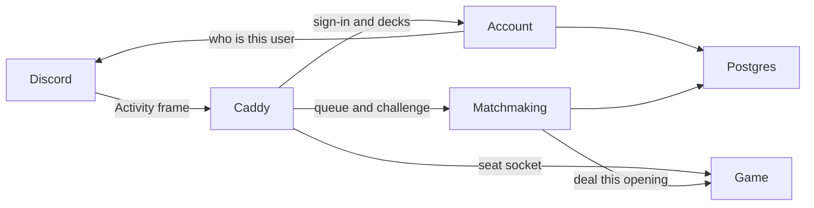

# Discord Activity (Phase 6)

The design for the next product phase, moved here from the [roadmap](../roadmap.md). Status: not started. Turn this into tasks before building. Building starts at the [Phase 6 gate](cr-audit-standardization-program.md#phase-6-gate) of the CR audit program.

The product is a Discord Activity on one Lightsail host (see Hosting below). Discord is the account and the only player conversation. Account checks the Discord user. Matchmaking checks the format and deals through a game container. That container sends only that seat's snapshot. The engine never sees a Discord user. A restart replays the applied-intent log, and matchmaking returns the same Discord user to the same seat.

## Hosting

**Public host.** One Amazon Lightsail instance in US East: 2 vCPUs, 4 GB memory, 80 GB disk, and a public IPv4 address. Ubuntu LTS runs Docker Compose. The verification table stays on a developer machine at `127.0.0.1` and is not this Compose file. A domain points at the instance. Cloudflare publishes that DNS record and does not proxy traffic. Caddy obtains the Let's Encrypt certificate. Secrets stay out of the images. Lightsail snapshots cover the machine. A Postgres dump covers the decks and the queue.

The code stays in `netrunner-game`. Account, matchmaking, the game host, and the Solid board are entry points of that repo. Caddy's configuration lives there too. Postgres is the stock database image plus the migrations.

| Piece | Runs on | Handles |
|-------|---------|---------|
| Lightsail instance | The one public server | Every container below. Volumes for certificates, Postgres, and match logs |
| Caddy | A container on that instance | The only public ports, 80 and 443. Serves the Activity board. Forwards sign-in, decks, and the queue to account and matchmaking. Forwards a seat socket to the game container that owns the match |
| Account | A container on that instance | Checks the Discord token with Discord and stores the Discord user and the deck library. The board, using Discord's embedded app SDK, sends the token here |
| Matchmaking | A container on that instance | The format check, challenges, and the Play queue. Pairs opposite sides. Tells a game container to deal and signs the one-match seat credential. A bot that opens a Discord channel waits until the Play queue needs one |
| Postgres | A container on that instance | Discord users, decks, the waiting list, challenges, and which game container owns which match. Match logs are not stored here |
| Game | A container on that instance | The pinned engine, cards, and Comprehensive Rules, loaded in the process. Applies intents, writes the intent log, and sends each seat only that seat's snapshot. Builds the delayed spectator view. Does not call Discord |

Caddy's image is its usual empty base. Account, matchmaking, and the game image are distroless Node images. Postgres keeps its ordinary image, and only account and matchmaking can reach it.

Full means a few hundred concurrent matches, or the memory and legality time of the one game container. The next step is a second copy of the game image, which can be another Lightsail instance. Postgres already names the owner of each match. Caddy sends that match's socket there. A faster legality check waits until a played match shows the current one is slow. Card definitions and Comprehensive Rules stay loaded with the engine inside the game container.

## Product

**Security.** The public game leaves localhost. Account checks the Discord user before matchmaking issues a seat credential. The game container accepts that credential and does not call Discord. The debug view names facedown cards and stays on the test table. A Discord message may say whose turn it is. A hand, a deck, and an unrezzed card stay out of Discord (CR 10.2.2a). Match logs stay on the game container's volume.

**Decks.** A player builds on NetrunnerDB and pastes a published link. The host turns that list into an identity and card ids, runs the construction check (CR 1.4), and stores a copy under the Discord user. When the match is dealt, the opening stores a second copy. A later edit to the library leaves the dealt match alone. A private NetrunnerDB login is later. The test table keeps its preset decks. NetrunnerDB is where the deck is edited. The pinned cards remain the titles, and a game in progress does not call NetrunnerDB.

**Formats.** Challenge and Play offer Learn to play, Core Sets, Startup, Standard, and Eternal. Ranked offers Core Sets, Startup, Standard, and Eternal. System Gateway is a set inside Core Sets, not a choice.

The first matches offer Learn to play and Startup only. Core Sets, Standard, and Eternal are added as each pool passes the seeded playouts and the visibility fuzz named in the gate.

Learn to play deals the fixed lists already in the host. Each player chooses the Corp list or the Runner list, and starter or expanded, before the match starts. Starter is the cards before the "STOP HERE" divider. Expanded adds the booster cards after it. The opening records that preset and that side. There is no restriction list.

For Core Sets, Startup, Standard, and Eternal, the host checks both decks against that format's card pool and the restriction list in force. The construction check still runs beside it. The list in force is the snapshot whose start date is today or earlier, and the latest such date when several qualify. In cards `v1.147.19` that is Standard Balance Update 26.08 and Startup Balance Update 26.05. The `active` flag still marks the March 2026 snapshots; the host follows the start date. Core Sets has a card pool and no restriction, so the pool is the whole check. The match records the format id and the restriction id. A later cards pin leaves a dealt match on the list it was checked against.

**Spectators.** Each player chooses whether to allow them before starting. The match has a spectator seat only when both allow it. That seat reads the applied-intent list behind the live match and sees the public view, in Challenge, Play, Ranked, and Learn to play. The two seats stay live. Spectators use their own Discord channel. When either player leaves it off, there is no spectator seat and the players' channel stays the two of them.

**A new ban list.** The catalog check, once it watches formats and restrictions, reports it. The cards repo takes that catalog commit, regenerates `data/formats/` and `data/restrictions/`, and cuts a cards tag. The game pin and the meta pin table move with it. The engine tag stays. The next challenge, queue entry, or deal uses the new list. The August 2026 Standard list and the May 2026 Startup list are already in `v1.147.19`, so they do not cause a release.

**Challenge** is how the first match starts. Both players have already chosen the format, the deck, and whether to allow spectators. One sends a request. The other accepts. The host deals when the decks are opposite sides and both pass. The two players talk in Discord.

**Exit:** Two Discord users play a match in an Activity. Each sees only their seat. Talk is Discord. A restart returns the same Discord user to the same seat. Challenge deals a format-checked match.
