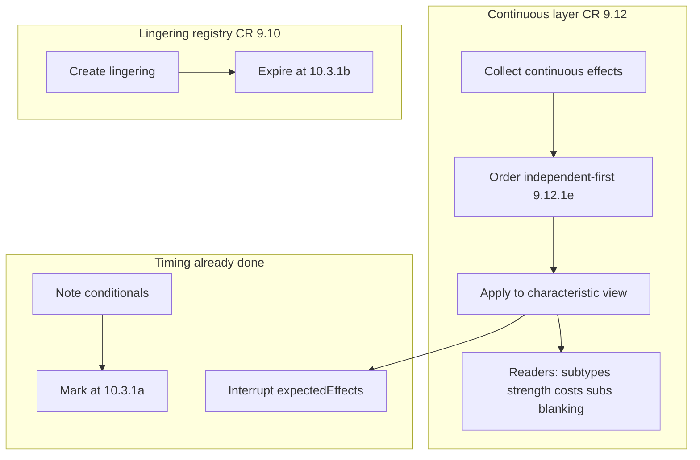

# Engine standardization program (maximal)

## North star

Standardize **how continuous characteristics, lingerings, and player choices are applied** so new cards plug into shared layers instead of new ad-hoc readers/mid-hooks—while keeping hand-authored Effect IR and **not** compiling CR prose / `nodes.json`.

Product Phase 5 (local table in `netrunner-game`) stays parallel; this is the next **engine** fidelity/architecture track after phases 1–4.

## Already standardized (do not reopen)

| Layer | Status |
|-------|--------|
| Conditionals → note → **10.3.1a** mark | Done (`v1.147.216`+; leftovers closed `v1.147.221`) |
| Interrupts + **9.9.9** replacements | Done (`replacements.ts`, strength-increase interrupt) |
| Blanking **9.12.1d/e** | Done ([`continuousEffects.ts`](https://github.com/nhoople/netrunner-engine/blob/master/src/state/continuousEffects.ts) → [`abilities.ts`](https://github.com/nhoople/netrunner-engine/blob/master/src/state/abilities.ts)) |
| **9.3** records at runtime | Done |

## Explicit non-goals

- Compiling CR prose or `nodes.json` into executable AST
- Magic-style ability stack
- Rewriting every `pendingChoice` in `eval.ts` in one pass (hundreds of sites; migrate by class)
- Inventing seat visibility the CR forbids

## Target architecture

Grow [`continuousEffects.ts`](https://github.com/nhoople/netrunner-engine/blob/master/src/state/continuousEffects.ts) from **blanking-only** into a **continuous characteristics layer**: collect typed effects (blank / grant-subtype / gain-sub / modify-value), order with the same **9.12.1d/e** rules already implemented for blanking, then have readers consume the solved view. That *is* the “general compiler” in practice—without a prose compiler.

## Phases (do not reorder)

### S0 — Charter and inventory (docs only)

- Add a short program note to [`docs/roadmap.md`](../../roadmap.md) Engine CR fidelity + a Cursor plan sibling to the fidelity program.
- Inventory continuous readers today: [`effectiveIceSubtypes`](https://github.com/nhoople/netrunner-engine/blob/master/src/cards/stubs.ts), ice/breaker strength, rez-cost helpers, Fatuma sync in [`graph.ts`](https://github.com/nhoople/netrunner-engine/blob/master/src/timing/graph.ts), dual-write fields in [`lingeringEffects.ts`](https://github.com/nhoople/netrunner-engine/blob/master/src/state/lingeringEffects.ts).
- Inventory mid-hook `pendingChoice` in [`graph.ts`](https://github.com/nhoople/netrunner-engine/blob/master/src/timing/graph.ts) (e.g. Security Nexus) vs Effect `choose` / pending abilities.

### S1 — Continuous subtypes (fidelity phase 5 + layer seed)

**Goal:** Gained subtype → further grant (Mother Goddess / Egret / Wetwork-class / Fatuma) matches CR; subtype grants go through the continuous layer.

- Extend `continuousEffects` with subtype-grant effects (Egret/Chromatophores host grants; Mother Goddess “gain subtypes of other rezzed ice”; encounter/turn granted subtypes).
- Mother Goddess consumes **layered** subtypes of others, not only `other.subtypes` printed ([`stubs.ts` ~738–753](https://github.com/nhoople/netrunner-engine/blob/master/src/cards/stubs.ts)).
- Keep blanking as the first-applied independent class (existing Hush×MG×Fatuma / Hush×Magnet tests must stay green).
- Tests: Egret→host→MG; gained bioroid→Fatuma; regression on [`cr-examples-ch9`](https://github.com/nhoople/netrunner-engine/blob/master/tests/cr-examples-ch9.test.ts) 9.12.1e examples.
- Ship as maintenance engine releases + game/meta pins (standing auth).

### S2 — Continuous characteristics beyond subtypes

**Goal:** Same layer covers the next high-traffic continuous mods.

- Fold into the layer (incremental PRs): Fatuma/Wetwork-style **gained subroutines**, then **strength** continuous mods that already call `effectiveIceSubtypes` / blanking, then **rez/install cost** continuous mods that depend on subtypes/blanking.
- Readers become thin wrappers over the solved characteristic view; delete duplicate blank checks where the layer already dropped inactive sources.
- Dual-run or feature-flag per family until goldens pass; one family per PR.

### S3 — Lingering single-write (**9.10**)

**Goal:** Strength/MU/blank lingerings are registry-authoritative; ad-hoc turn/run maps become derived or removed.

- Today dual-writes: `breakerStrengthBoostsThisTurn`, `run.strengthBoosts`, `encounterStrengthBoosts`, `checkpointBreakerBoosts`, ice analogs, `runnerMuModifierUntilTurnEnd`, etc. ([`lingeringEffects.ts`](https://github.com/nhoople/netrunner-engine/blob/master/src/state/lingeringEffects.ts)).
- Migrate consumers ([`iceStrength.ts`](https://github.com/nhoople/netrunner-engine/blob/master/src/effects/iceStrength.ts), stubs, checkpoints **10.3.1b**) to read lingerings (or a single derived cache filled from lingerings).
- Drop dual-write once one family is green; repeat.

### S4 — Choice path standardization

**Goal:** Timing-graph mid-hooks that are really “may / choose” become pending abilities or Effect `choose` after the right window—not new `state.pendingChoice =` in [`graph.ts`](https://github.com/nhoople/netrunner-engine/blob/master/src/timing/graph.ts).

- Start with graph mid-hooks (Security Nexus–class encounter offers).
- Shared helper: open choose-options pending from a small API (wraps existing `pendingChoice` / pending-ability resume) so primitives stop inventing shapes.
- Do **not** mass-rewrite `eval.ts` / `*Primitives.ts` choose sites in this phase; migrate when touching a family. Track remaining mid-hooks as a punch list.

### S5 — Seat visibility module

**Goal:** One policy module for what a seat may see (CR **1.18** / zone openness), used by [`getPublicView`](https://github.com/nhoople/netrunner-engine/blob/master/src/api/library.ts).

- Extract zone/face/counter visibility rules from the public-view builder into a named module with tests against CR examples already in `cr-examples-ch*`.
- Table keeps consuming `getPublicView`; no protocol change required.

### S6 — Static continuous declarations

**Goal:** Continuous modifiers are data the layer collects, not only boolean projections + bespoke readers.

- Prefer **9.3** static declarations / small continuous-effect records on cards for new and migrated continuous abilities (grant subtype, blank host, modify strength/cost).
- Load-time projections may remain until a family is fully on the layer; stop adding new one-off booleans when a declaration shape exists.
- Cards-data changes only when a declaration schema is needed; pin policy unchanged (maintenance vs set-complete).

## Sequencing rules

- One family / layer slice per PR; engine tests + release when `src/` changes; pin game/meta.
- Never break Standard blanking or 9.12.1e examples to land Eternal subtypes.
- Prefer extending [`continuousEffects.ts`](https://github.com/nhoople/netrunner-engine/blob/master/src/state/continuousEffects.ts) over a second parallel solver.
- Update fidelity/roadmap docs when a phase exits; known-gaps line tracks “standardization S*n done.”

## Success metrics

- New continuous dependency cards do not need a new `effective*` special case.
- Lingerings expire only via **10.3.1b** registry path for migrated kinds.
- No new timing-graph mid-hook `pendingChoice` for conditional “may” abilities.
- Public view visibility changes cite CR and go through one module.

## First implementation slice (after plan approval)

**S0 charter + S1 continuous subtypes** — closes fidelity phase 5 and seeds the general continuous layer.
