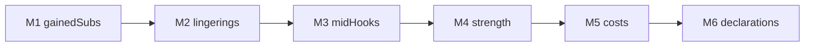

# Framework migration program

## Context

[`v1.147.222`](https://github.com/nhoople/netrunner-engine/releases/tag/v1.147.222) shipped the **framework** (continuous subtypes/blanking, Fatuma collector, lingering helpers, `openPendingChoose`, seat visibility, `continuousSubtypeGrants`). Most strength/cost math, dual-write maps, graph mid-hooks, and gained-sub sync still sit outside those layers. This program is the **migration**, not a new architecture.

Explicit non-goals (unchanged): no CR-prose compiler; no mass rewrite of `eval.ts` Effect `choose`; no Magic-style stack.

Inventory remainders live in [`docs/engine-standardization-inventory.md`](engine-standardization-inventory.md). Update that doc + roadmap when each phase exits.

Do **not** reorder: gained-subs finish unblocks subtype-correct strength; lingerings before strength-layer fold avoids a second strength rewrite; mid-hooks are independent but stay after lingerings so releases stay one-family; cost after strength; declarations last so shapes match migrated families.

## M1 — Finish gained-subs collectors

**Goal:** Graph only applies a unified continuous-subs list; no more inline Wetwork/Sub Boost special cases that bypass the layer.

- Wire [`collectHostedConditionSubsBeforePrinted`](https://github.com/nhoople/netrunner-engine/blob/master/src/state/continuousSubs.ts) into [`graph.ts`](https://github.com/nhoople/netrunner-engine/blob/master/src/timing/graph.ts) encounter begin (replace the inline Wetwork loop; keep blanking gate).
- Move **Sub Boost** barrier grant into [`resolveIceSubtypeMap`](https://github.com/nhoople/netrunner-engine/blob/master/src/state/continuousEffects.ts) / a subtype-grant kind; stop mutating `ice.subtypes` in `syncHostedSubBoost`.
- Add collectors for the remaining graph sync families (one PR or tightly related PRs): Winchester HQ, Blockchain archives, Woodcutter/Tyrant advancement, NEXT Opal (use **layered** subtypes), Brainstorm grip, Tour Guide assets.
- Tests: Wetwork blanking; Sub Boost → MG/Fatuma chain if applicable; existing gained-sub goldens stay green.
- Ship maintenance release + game/meta pins per standing policy.

## M2 — Lingering single-write (drop dual-write maps)

**Goal:** Registry is the only strength/MU source for migrated kinds; maps removed or derived.

Prior failed approach: “prefer lingerings else maps” broke harden-unsupported / map-seeded fixtures. **Rule:** for each kind, switch readers + writers + hostDuration + tests in one PR; no hybrid prefer.

Order (one kind per PR unless noted):

1. `breaker_strength_turn` — [`stubs.ts`](https://github.com/nhoople/netrunner-engine/blob/master/src/cards/stubs.ts) `effectiveBreakerStrength`, [`strengthIncrease.ts`](https://github.com/nhoople/netrunner-engine/blob/master/src/state/strengthIncrease.ts), [`hostDuration.ts`](https://github.com/nhoople/netrunner-engine/blob/master/src/state/hostDuration.ts) turn bucket, [`checkpoints.ts`](https://github.com/nhoople/netrunner-engine/blob/master/src/legality/checkpoints.ts), pump before/after in eval/primitives; rewrite map-seed tests to helpers.
2. `breaker_strength_encounter` + `breaker_strength_run` together (System Seizure / Gamedragon / rekind couple them).
3. `breaker_strength_checkpoint`.
4. `ice_strength_turn` then `ice_strength_encounter`.
5. `runner_mu` ([`turn.ts`](https://github.com/nhoople/netrunner-engine/blob/master/src/state/turn.ts) `memoryLimit`; single write in lunar primitives).
6. Defer `ability_blank` until Klevetnik lingerings are cleanly separated from Magnet continuous blank flags.

## M3 — Graph mid-hook → `openPendingChoose`

**Goal:** No new raw `state.pendingChoice =` for may/choose mid-hooks; migrate the punch list.

Already done: Security Nexus. Migrate next (smallest first), each PR 1–3 sites:

1. Zahya, Lightning Laboratory  
2. S-Dobrado Threat, Alarm Clock, Femme Fatale  
3. Snitch  
4. Omar/Sneakdoor  
5. Security Testing, Baker  
6. Mumbad City Grid, ZATO City Grid, Awakening Center  

Defer forced/tax shapes (Rigged Results, Cayambe/Manegarm taxes, Biotech face, delayed run-end order). Leave `eval.ts` and existing `noteInlineConditional` / pending-ability sites alone.

## M4 — Strength onto the continuous layer

**Goal:** Continuous strength mods collect/solve like subtypes; `effectiveIceStrength` / `effectiveBreakerStrength` become thin wrappers.

- Collect continuous strength effects (static card bonuses, subtype-gated bonuses) after blanking + subtype resolve.
- Fix correctness gaps that still read **printed** subtypes (Stronger Together, Wraparound-class, NEXT Opal counts, `scoredAgendaIceSubtypeStrengthBonus` in [`breakerMods.ts`](https://github.com/nhoople/netrunner-engine/blob/master/src/state/breakerMods.ts)) to use `resolveIceSubtypes` / `effectiveIceSubtypes`.
- Temp pumps come from M2 lingerings, not ad-hoc maps.
- Dual-run or golden parity until suite green; one PR family (ice static continuous, then breaker static, then scored/agenda helpers).

## M5 — Cost continuous mods

**Goal:** Rez/install continuous increases/reductions collected by the layer.

- Fold [`continuousIceRezCostIncrease`](https://github.com/nhoople/netrunner-engine/blob/master/src/cards/stubs.ts) (already subtype-aware) into collect/solve first.
- Then other rez helpers in stubs; then Runner install continuous mods in [`installRunner.ts`](https://github.com/nhoople/netrunner-engine/blob/master/src/actions/installRunner.ts).

## M6 — Static declarations for migrated families

**Goal:** Stop new one-off booleans when a declaration shape exists.

- Extend beyond `continuousSubtypeGrants`: gained-sub / strength / cost declaration records projected in [`load.ts`](https://github.com/nhoople/netrunner-engine/blob/master/src/cards/load.ts) as families migrate.
- Cards-data schema only when a new declaration field is required; pin policy unchanged.

## Sequencing / ship rules

- One family (or listed mid-hook batch) per PR; `npm test` green; engine maintenance tag when `src/` changes; pin game + meta.
- Never break Standard blanking or 9.12.1e examples for Eternal convenience.
- Prefer extending [`continuousEffects.ts`](https://github.com/nhoople/netrunner-engine/blob/master/src/state/continuousEffects.ts) / [`continuousSubs.ts`](https://github.com/nhoople/netrunner-engine/blob/master/src/state/continuousSubs.ts) over parallel solvers.
- Known-gaps line: “framework migration M*n* done.”

## First implementation slice (after approval)

**M1a — Wetwork collector + Sub Boost subtype grant** in `continuousSubs` / `continuousEffects` + `graph.ts`, with tests, release, and pins. Then continue M1 remaining collectors without stopping for a new plan.
