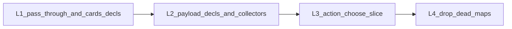

# Leftovers: long-term support track

Floor: engine `v1.147.231`, cards `v1.147.13`. Not a new S-program — four maintenance/paired slices, then stop.

## Defaults (locked)

- **In scope:** cards decls for the six continuous cards; Fatuma / Wetwork / Sub Boost collector collapse; action-layer + `chooseCard` → `openPendingChoose`; delete unread strength/MU duration maps.
- **Out of scope:** Winchester / Blockchain / Opal / Tour Guide / Brainstorm / advancement gained-sub flags; mass `eval.ts` / pack-primitive `pendingChoice` rewrite; Magnet forced onto `ability_blank` lingerings; Product Phase 5 table work.
- **Release:** engine maintenance tags per `src/` PR; the cards rewrite is a **paired cards+engine** bump (not a set-complete). Game + meta pins after each engine release that consumers need; cards pin moves only on the paired cut.

## L1 — Prefer card-supplied decls + author the six

**Engine** ([`netrunner-engine/src/cards/load.ts`](https://github.com/nhoople/netrunner-engine/blob/master/src/cards/load.ts)): today `instantiateCard` **overwrites** any card-supplied continuous arrays with boolean projections. Change to: if `def.continuousSubtypeGrants` / `def.continuousGainedSubDecls` present, use them; else keep projecting from the four flags. Keep collector boolean fallbacks.

**Cards** (paired release): add the two array properties to [`netrunner-cards-data/data/schema.json`](https://github.com/nhoople/netrunner-cards-data/blob/master/data/schema.json); rewrite the six cards that already use flags via `abilities[].declaration`:

| Card | Decl(s) |
|------|---------|
| `mother-goddess` | `copy_other_rezzed_ice_subtypes` |
| `egret`, `chromatophores` | `host_grant_bcs` |
| `sub-boost` | `host_grant_barrier` + `sub_boost_etr` |
| `wetwork-refit` | `wetwork_hosted_before` (+ keep sub list on hosted field until L2) |
| `warden-fatuma` | `fatuma_lose_click` |

Keep the legacy flags on those cards through L1 so pin skew stays safe. Generators that emit the flags can keep emitting them until L2 drops the need.

**Tests:** load/instantiate prefers card decls when both present; existing continuous-gained-subs / subtype tests stay green against pinned cards after the bump.

**Ship:** cards tag + engine tag (pass-through) + game/meta pins.

## L2 — Payload decls; collapse three collectors

Extend gained-sub decl shapes beyond markers so collectors stop hardcoding text/effect/position:

- `fatuma_lose_click` — carry lose-click subroutine payload (or a shared constant keyed by kind once).
- `sub_boost_etr` — carry ETR sub payload + `after`.
- `wetwork_hosted_before` — own the hosted sub list + `before` (migrate off `hostGainsSubroutinesBeforePrinted` as the grant source).

Then simplify [`continuousSubs.ts`](https://github.com/nhoople/netrunner-engine/blob/master/src/state/continuousSubs.ts) `collectFatumaGainedSubs` / `collectSubBoostEtrSubs` / `collectHostedConditionSubsBeforePrinted` to walk decls only. Drop boolean fallbacks **for those three kinds** once cards no longer need the flags. Leave Winchester-family collectors flag-driven.

[`continuousEffects.ts`](https://github.com/nhoople/netrunner-engine/blob/master/src/state/continuousEffects.ts) subtype grants already kind-driven — drop the boolean OR branches for the six after L1 cards are the floor.

**Ship:** engine maintenance (and cards if Wetwork payload moves off the hosted array field).

## L3 — Action-layer choose slice

Route remaining **framework opens** through [`openPendingChoose`](https://github.com/nhoople/netrunner-engine/blob/master/src/state/pendingChoice.ts) (same class as graph mid-hooks):

- [`installRunner.ts`](https://github.com/nhoople/netrunner-engine/blob/master/src/actions/installRunner.ts), [`installCorp.ts`](https://github.com/nhoople/netrunner-engine/blob/master/src/actions/installCorp.ts), [`rez.ts`](https://github.com/nhoople/netrunner-engine/blob/master/src/actions/rez.ts), [`play.ts`](https://github.com/nhoople/netrunner-engine/blob/master/src/actions/play.ts), [`run.ts`](https://github.com/nhoople/netrunner-engine/blob/master/src/actions/run.ts), [`access.ts`](https://github.com/nhoople/netrunner-engine/blob/master/src/actions/access.ts) (~15 opens)
- [`effects/chooseCard.ts`](https://github.com/nhoople/netrunner-engine/blob/master/src/effects/chooseCard.ts)

Leave `eval.ts` / `*Primitives.ts` (~700 sites) and `apply.ts` null-clears alone. No `closePendingChoice` helper unless a clear duplication shows up mid-slice.

**Ship:** engine maintenance + pins.

## L4 — Delete dead strength/MU duration maps

Maps are init/clear-only; rules readers already use lingerings. Rewrite inject tests in [`tests/cr-examples-ch10.test.ts`](https://github.com/nhoople/netrunner-engine/blob/master/tests/cr-examples-ch10.test.ts) and [`tests/instruction-checkpoints.test.ts`](https://github.com/nhoople/netrunner-engine/blob/master/tests/instruction-checkpoints.test.ts) to seed lingerings, then remove:

- turn/run map fields and their init/clear in `turn.ts`, `checkpoints.ts`, `graph.ts`, run construction
- debug/key-count bookkeeping that only exists for those maps (`passedRunDurationCount` if map-only)

**Ship:** engine maintenance + pins.

## Explicitly deferred (do not force in this track)

- **Magnet → lingerings:** wrong model (CR 9.12 continuous, not 9.10). Hush×Magnet already works via blanking collectors. Optional later: stop the onRez `abilitiesBlanked` stamp once continuous-only is the only production path — not part of L1–L4.
- **Winchester-family decl expansion:** separate pass when the next such card appears.
- **eval/pack `pendingChoice` mass migrate:** opportunistic when touching a family.

## Docs / EOS

Update [`docs/engine-standardization-inventory.md`](../../engine-standardization-inventory.md) and floor lines in [`docs/git-hygiene.md`](../../git-hygiene.md) / roadmap baseline as each slice ships. End-of-session sync per standing hygiene.