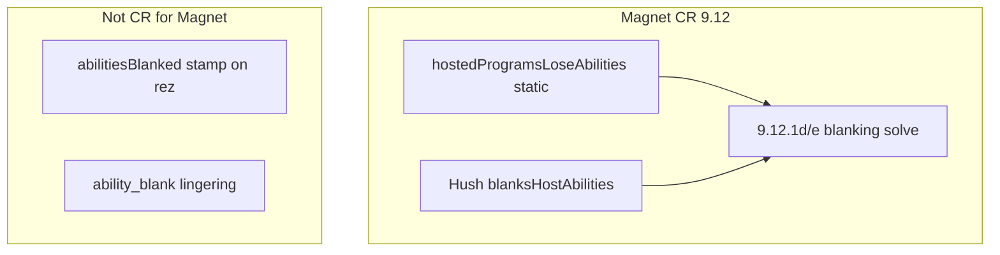

# Magnet continuous-only + Winchester-family decls

Floor: engine `v1.147.235`, cards `v1.147.15`.

## Locked approach

- **Magnet:** CR-correct path is **continuous-only**. Magnet’s blank is a static **9.12** ability (`hostedProgramsLoseAbilities`), ordered with Hush via **9.12.1d/e** (engine test CR 9.12.1e.ex2). It is **not** a **9.10.1** lingering. Do **not** invent a while-hosted lingering duration.
- **Winchester-family:** Same L2 pattern — author `continuousGainedSubDecls` (or typed sibling kinds) on the ice, collectors prefer decls, drop flag-only branches once cards pin moves.

## M1 — Magnet stamp-drop (engine maintenance)

1. In [`netrunner-engine/src/effects/eval.ts`](https://github.com/nhoople/netrunner-engine/blob/master/src/effects/eval.ts) `host_ice_program_on_self`: stop setting `prog.abilitiesBlanked = true`.
2. In [`continuousEffects.ts`](https://github.com/nhoople/netrunner-engine/blob/master/src/state/continuousEffects.ts) `collectBlankingEffects`: drop the production path that treats `abilitiesBlanked` + Magnet host as a blank source. Keep Klevetnik via `ability_blank` lingerings. Keep a narrow test-injection path only if still needed for non-Magnet blanked-* suites (or migrate those suites to lingerings / continuous flags and delete the flag reader entirely if cheap).
3. Prove Hush×Magnet still green: [`tests/cr-examples-ch9.test.ts`](https://github.com/nhoople/netrunner-engine/blob/master/tests/cr-examples-ch9.test.ts) 9.12.1e.ex2 and [`tests/blanking-solver.test.ts`](https://github.com/nhoople/netrunner-engine/blob/master/tests/blanking-solver.test.ts).
4. Ship: engine maintenance tag + game/meta pins. No cards release.

## W1 — Winchester-family decls (paired cards+engine)

Cards that still use gained-sub flags (from cards-data):

| Card | Current field | Decl kind (new) |
|------|---------------|-----------------|
| Winchester | `gainsSubroutinesWhileProtectingHq` | `hq_protect_subs` (+ sub list payload) |
| Blockchain | `gainsSubroutinesBeforePrintedPerFaceupArchives` | `archives_faceup_per` (+ spec payload) |
| Woodcutter, Tyrant, Swarm, Salvage, Masvingo | `gainsSubroutinesPerAdvancement` | `per_advancement` (+ subroutine template) |
| NEXT Opal | `gainsSubroutinesPerRezzedIceWithSubtype` | `per_rezzed_subtype` (+ subtype + template) |
| Brainstorm | `gainsSubroutinesOnEncounterEqualGripSize` | `grip_size_on_encounter` (+ template) |
| Tour Guide | `etrSubroutinesPerRezzedAsset` | `etr_per_rezzed_asset` |

1. Extend [`ContinuousGainedSubDecl`](https://github.com/nhoople/netrunner-engine/blob/master/src/state/types.ts) / cards [`schema.json`](https://github.com/nhoople/netrunner-cards-data/blob/master/data/schema.json) with those kinds + payloads (mirror L2 Wetwork/Fatuma shape).
2. [`load.ts`](https://github.com/nhoople/netrunner-engine/blob/master/src/cards/load.ts): prefer card-supplied decls; keep projecting from legacy flags until flags removed.
3. Rewrite collectors in [`continuousSubs.ts`](https://github.com/nhoople/netrunner-engine/blob/master/src/state/continuousSubs.ts) to walk decls (scope math stays in the collector: HQ-only, archives count, advancement count, etc.).
4. Cards: add decl abilities on the ~10 ice; keep legacy flags through one overlap pin, then drop flags + boolean fallbacks on the next paired cut (or same paired cut if engine falls back for unprojected stamps only in tests).
5. Update pack/generators + pin asserts; cards tag + engine tag; game/meta pins.

## Out of scope

- Mass `eval.ts` / pack `pendingChoice` migration.
- New Magnet lingering duration kinds.
- Product Phase 5 table work.

## Ship / EOS

Standing hygiene: tests green per repo, PR → squash-merge → maintenance/paired tags → game + meta pins → checkouts on master/main. Update [`docs/engine-standardization-inventory.md`](engine-standardization-inventory.md) when both slices land.
