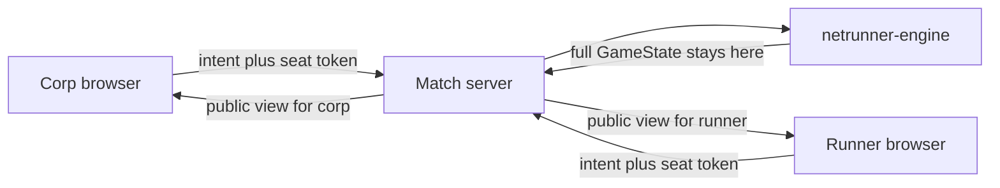

# Basic two-seat test table

The finished product is a browser play site in the same role as [jinteki.net](https://www.jinteki.net/): people bring decks, sit at a table, take actions the server accepts, watch games, read a log of what happened, and eventually play those matches inside a tournament. Talk is a panel on the table, backed by a Discord thread so the Discord app does not have to stay open. This project does not port jinteki's client or its Clojure rules. Rules stay in `netrunner-engine`.

This slice is the test table, not that site. Two browsers join one match, each sees only its seat, and legal clicks go through the engine. Accounts, a lobby, persistence, and more than one server process are not implemented now.

The engine is already the rules library and is explicit that it has no sockets or UI. New work stays in [netrunner-game](https://github.com/nhoople/netrunner-game) and calls the host API in [deps/netrunner-engine/src/api/library.ts](https://github.com/nhoople/netrunner-engine/blob/master/src/api/library.ts):

- `createGame`
- `queryLegality`
- `applyIntent`
- `getPublicView(state, side)`

`getPublicView` already hides the opponent’s hand and unrezzed ice titles. It still deep-copies `run`, `log`, and several `pending*` fields, so the host must treat it as a starting point and prove the bytes on the wire do not contain the other seat’s secret card ids.

## Security

- The server owns `GameState`. Clients send an intent; they never send state.
- Creating a match returns two unguessable seat tokens (corp and runner). A socket is bound to one seat. The match id alone does not reveal hidden cards.
- An intent is applied only when `queryLegality` lists it for that seat’s actor. The other seat’s token cannot play it.
- Each message is `getPublicView` plus that seat’s legal intents. A test builds a game, then asserts the runner payload JSON does not contain corp deck or hand card ids (and the reverse). If `run`, `log`, or `pending*` leak those ids, strip them in the host before send.
- Intents for one match run on a per-match queue so two messages cannot apply at the same time.

## Performance and scale

- One Node process holds many matches in a `Map`. Matches do not share mutable state, so a later router can pin a match id to a process without changing the rules code.
- Card definitions stay loaded once in the engine. The wire format is the seat view, not the 2,382-card catalog and not `GameState`.
- No Redis, accounts, or extra nodes in this slice. Those are how you add rooms later; they are not required to keep matches isolated.

## Seams this slice must keep

Later slices replace the browser page, the match directory, and how a game is set up. They should not replace the match rules.

- `src/match.ts` does not import the WebSocket library. The server adapts a socket to `join(token)` and `submit(token, intent)`.
- The seat token is the credential. The connection is not. Closing a socket leaves the match in memory so a later reconnect can attach a new socket to the same token.
- Wire messages are a small set: `welcome` (match id and seat), `snapshot` (view plus that seat's legal intents), `chat`, and `error`. Each message has a version. Clients ignore unknown fields, so a later clock or prompt can be added beside the view. The client never sends or receives `GameState`. Buttons submit an intent copied from the legal list, so the page does not invent action shapes. The client attaches an id to each intent. A repeat of that id does not apply twice.
- Table talk is a panel on the page, not a second application. Discord does not allow its client to be framed inside another site, so the match server proxies chat. The browser sends `{ type: "chat", room, text }`. There are two rooms. `table` is the two seats only. `spectator` is watchers only, and those lines are never delivered to a seat, so watchers can talk without telling the players what they see. The Discord bot token stays on the server. Chat is still not `GameState` and is never parsed as an intent. This slice defines that chat port and tests that a spectator-room line does not reach a seat. Without a bot token it echoes through an in-memory adapter. Swapping in the Discord adapter later does not change the page or the match rules. The test page only opens the table room, because this slice has no spectator connection.
- One function builds the snapshot for a viewer role: `corp`, `runner`, or `spectator`. Seat roles start from `getPublicView`, then strip leaked secret ids, then attach that seat's legal intents. A spectator is not either seat: `getPublicView` includes that side's hand, so a spectator must not be given a corp or runner snapshot. The spectator snapshot shows public board info only (counts, rezzed and face-up cards, scores) and an empty legal-intent list. This slice implements that function and tests it. It does not open a spectator connection.
- `createMatch` accepts an optional setup function and passes it to `createGame`. This slice passes the System Gateway learn-to-play decks. A later deck slice can pass a different loader without changing the wire protocol.
- Matches live behind `create` and `get`. The first store is an in-memory `Map`. A durable store later implements the same two operations. State stays a plain engine object, with no closures stored on it, so it can be serialized later. A lobby later lists those matches. It does not reach into a socket.
- Each applied intent is appended to a game log on the match: sequence, seat, intent, and whether it was legal. That log is the jinteki-style action history and the source for replay. It is not chat and it is not `GameState`. This slice records it and shows the lines on the test page.
- A match can carry optional labels (`tournamentId`, round, table, game number, format) and exposes a result: done or not, winner, and win reason. The rules ignore the labels. A tournament later creates matches and reads results. This slice accepts empty labels.
- Ending a game is either the engine setting `done`, or a host action recorded in the game log: concede, intentional draw, or a judge ruling. That host action is not an `applyIntent` and not a card. This slice includes concede so the log already has a place for it. Round clocks and judge tools call the same action later.
- Secret-stripping removes the other seat's hidden card ids. It keeps the acting seat's own log, including cards that seat has already seen. Server logs and error text must not print a full `GameState` or a deck list.
- A decklist submitted before the game starts is shown only to the seat that submitted it. The opponent's snapshot does not include that list. This slice does not collect lists. The waiting phase later must follow this rule.

## Later slices

Not built now. Each one uses the seams above.

- **Lobby.** A page lists open matches and creates one. Joining a side still means holding that seat token. The test slice skips the list and hands out two links.
- **Decks.** Both seats submit decklists before the first intent, the way a jinteki game starts from two decks. The server builds state with `createGame({ setup })`. The protocol grows a waiting phase. The learn-to-play lists stay the default when nobody submits a list.
- **Reconnect.** A new socket presents the same seat token and receives a fresh snapshot plus the game log. Disconnect already does not delete the match.
- **Table UI.** A board replaces `public/table.html`: servers, ice, hand, clicks, and credits from the snapshot, with card text from the vendored card data. It still sends intents from the legal list and prints the game log.
- **Persistence.** The match directory writes state and tokens. Restart reloads them. The match queue and view function stay in process.
- **More than one process.** A router pins each match id to one process. Match code does not change. The client still opens one URL.
- **Accounts.** A user owns a seat token. The token remains the match credential. This slice does not treat the token as a user id.
- **Spectators.** A watch link joins with role `spectator`, receives the spectator snapshot, and chats in the `spectator` room. No second rules path. Players never see that room. A delay, so a spectator cannot relay hidden info through some other channel, can wrap that same snapshot later. The watch link itself is not part of this slice.
- **Replay.** A finished match can be re-played by running the game log through `applyIntent` from the same setup. No new rules path.
- **Discord thread adapter.** The chat port posts each room into its own private Discord thread and subscribes to both, so someone who does have Discord open sees the same lines. The table thread and the spectator thread stay separate. The game remains the app they need open. Not required for the test table, which uses the in-memory adapter.
- **Tournaments.** A tournament is a list of rounds above matches. It pairs accounts, locks the decklists those players already submitted, creates one match per table with labels, and records each match result when the game ends. A second game at the same table is a new match with a new game number, not a second `GameState` inside the first. Swiss or elimination scoring lives here, not in the engine. A round clock ends a table through the same host action as concede. Replays and the game log are the appeal record. This depends on accounts, decks, and persistence. It is not part of this slice.

## First playable slice

- `src/decks.ts`: the Null Signal System Gateway learn-to-play starters, loaded with the engine's `instantiateCard`. Corp is The Syndicate: Profit over Principle and 34 cards (Offworld Office through Manegarm Skunkworks, as on the [Corp learn-to-play guide](https://nullsignal.games/players/learn-to-play/learn-to-play-corp/)). Runner is The Catalyst: Convention Breaker and 30 cards (Tread Lightly through Verbal Plasticity, as on the [Runner guide](https://nullsignal.games/players/learn-to-play/learn-to-play-runner/)). Those are the cards before the "STOP HERE" divider, not the booster pack. Every title is in the pinned `system-gateway` data with an empty `unsupported` list. Shuffle, draw 5, and set the win target to 6 agenda points, which is the guide's first game. The engine's placeholder decks (`corp-fill-1`, and so on) are not used.
- `src/match.ts`: create match, join by token, submit intent, snapshot for a seat. `createMatch` passes this setup into `createGame`.
- `src/server.ts`: WebSocket server (the `ws` package) plus a static page.
- `public/table.html`: show the seat view, buttons for legal intents, the game log, and a chat panel. Opening the corp link and the runner link in two browsers plays the learn-to-play decks. A line sent on one seat appears on the other through the chat port.
- `src/match.test.ts`: hidden-information test, rejected cross-seat intent, a spectator snapshot that contains neither seat's hand or deck ids, and a spectator-room chat line that is not delivered to either seat. Node’s built-in test runner.
- Scripts: `start` and `test`. Update the README with how to open both seats.

Verify in the browser with two tabs: each seat sees its own hand, neither sees the other’s deck order, and a legal click updates both views.