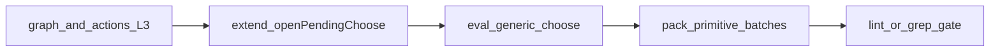

# Safely migrate IR/pack `pendingChoice` opens

**Status (reviewed 2026-11-11):** mostly done. `openPendingChoose` takes `loopCount`, and raw `state.pendingChoice = {` opens are down from about 715 to 2: `src/actions/costCards.ts:216` and `src/state/msKeywords.ts:65`. Remaining: migrate those two, then add the exit gate (step 4), which does not exist yet.

**Answer:** Yes, but not as one bulk search-replace. Shapes are almost uniform; the risks are `loopCount`, empty-option no-ops, and silent “already pending” no-ops. Migrate by tested families with a helper extension first.

Floor after leftovers: engine `v1.147.235`. Graph + action-layer already use [`openPendingChoose`](netrunner-engine/src/state/pendingChoice.ts). Remaining: ~315 opens in [`eval.ts`](netrunner-engine/src/effects/eval.ts) + ~400 in `*Primitives.ts`.

## Why not one PR

- **`loopCount`:** Mandatory-loop open at `eval.ts` ~15172 sets `loopCount: true`; [`chooseOption`](netrunner-engine/src/actions/apply.ts) reads it. Current helper strips unknown fields.
- **Empty options:** Raw assign can open `options: []`; helper no-ops. Rare, but behavior changes if any caller relies on a stuck empty choice.
- **Already-pending:** Most opens are unguarded. Helper returns `false` without opening; callers that log or mutate after a raw overwrite could diverge. Prefer `logLine` + check return where needed.
- **Clears stay raw:** `= null` in eval/apply/primitives is fine; no need for `closePendingChoice` in this track.

## Locked approach

1. **Extend helper** (small maintenance PR): optional `loopCount?: boolean` on `openPendingChoose` args; pass through onto `PendingChoice`. Unit tests: open, refuse-if-pending, refuse-empty, `logLine`, `loopCount` round-trip with the ch10 mandatory-loop example.
2. **Eval generic path first:** Convert the shared Effect `choose` opener and other high-traffic eval helpers that build `{sourceId, chooser, options}` — one PR, full `npm test`. Exempt only if a site is the temporary-open-then-immediately-clear pattern (`eval.ts` ~8069) where helper semantics differ; keep that site explicit.
3. **Pack batches:** Convert `*Primitives.ts` by wave/pack (e.g. Kitara, Flashpoint, Red Sand) — one pack file group per PR, run that pack’s tests + suite. Mechanical: replace open assigns with `openPendingChoose`; fold adjacent `log(...)` into `logLine` when equivalent.
4. **Exit gate:** When eval + all primitives have no raw **opens**, add an eslint ban or CI grep that fails on `state.pendingChoice = {` outside `pendingChoice.ts` / allowed clears. Clears (`= null`) remain allowed in apply/eval.

## Out of scope

- Rewriting `apply.ts` null-clears or inventing `closePendingChoose` unless duplication appears mid-track.
- Changing `PendingChoice` resolution protocol or seat visibility.
- Product Phase 5 table work.

## Ship policy

Each `src/` slice: engine tests green → PR → maintenance tag → game + meta pins (standing). Prefer one family per release so a regression is bisectable.

## Success

- Zero raw pendingChoice **opens** outside the helper.
- Mandatory-loop + choice-timing + pack suites green.
- New choose windows in IR/packs go through one API.