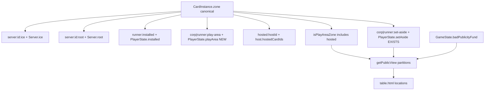

# Play-area unification (option 3) + open locations

## Goal

Make the engine and table tell the same CR zone story for locations that today are modeled in state but missing (or incomplete) on the seat view:

- **Play area (4.6)** — one zone, partitions as locations/views, including lingering ops/events/currents/lockdowns **and hosted cards**
- **Set-aside (4.8)** — shared temporary zone already has `PlayerState.setAside` + `*:set-aside` zones; not in `getPublicView` / table
- **Bad publicity fund (10.6.2)** — `GameState.badPublicityFund` exists; table only shows corp bad-publicity *count*, not the fund credits

Cite: **4.6.2** / **4.6.3** (play area count/location/face), **4.6.5g** / **4.6.5h** (host and hosted both in play area; hosted may be installed or not), **4.6.6+** (server organization), **4.8.1** / **4.8.6** (set-aside), **10.6.2** (BP fund).

## Non-goals

- Do **not** flatten ice, root, and runner installed into a single unordered list.
- Do **not** invent a card ZoneId for the bank (**4.7** stays credit/counter supply; only the BP fund location is surfaced).
- Do **not** invent a separate “hosted partition” bag — hosting stays `hostId` / `hostedCardIds` / `hosted:${hostId}` zone.
- Do **not** change cards-data IR for this work (engine + game; release tags when shipping).
- Card-level `persistent` declaration cleanup and dropping the overadvance load rewrite stay follow-ups, not this pass.

## Target model

- **Canonical:** `CardInstance.zone` (already).
- **Partition indexes:** keep `Server.ice` / `Server.root` / `PlayerState.installed` / `PlayerState.setAside` / `hostedCardIds`; **add** `PlayerState.playArea: string[]` for non-installed play-area cards (today zone-only).
- **Membership API** in [`zones.ts`](netrunner-engine/src/state/zones.ts): extend `isPlayAreaZone` to treat `hosted:${id}` as play area (**4.6.5g/h** — today it does not); add `playAreaCardIds`, `isInPlayArea`, lingering filters; set-aside stays its own zone (not play area).
- **Mutation path:** install / play / trash / move helpers update zone **and** the matching bag. Fix `removeCardFromCurrentZone` so play-area bags leave cleanly (set-aside and host lists already have dedicated paths).

## Engine slices

### A — Membership + sync bags
- Add `playArea` on corp/runner in [`types.ts`](netrunner-engine/src/state/types.ts) / createGame / shortGame.
- Wire place/trash paths in [`play.ts`](netrunner-engine/src/actions/play.ts), currents, lockdowns, and other writers of `corp:play-area` / `runner:play-area` to push/pop `playArea`.
- Centralize leave-zone cleanup so play-area bags stay consistent with `installed` / servers.
- Unit tests: place op/event → in `playArea` + zone; trash/linger/remove → bag empty; `isPlayAreaZone` covers the four play-area partitions.

### B — Route “in play?” through helpers
- Extend `isPlayAreaZone` / `playAreaCardIds` so `hosted:*` counts as play area (**4.6.5g/h**).
- Replace ad hoc `zone === "corp:play-area"` / Object.values scans for membership with helpers (currents, lockdowns, timing graph turn-begin).
- Leave loops on `runner.installed` / `server.ice` where they mean that **partition**.
- Update glossary / [`cr-term-map.json`](netrunner-engine/data/cr-term-map.json): play-area partitions as views; hosted is play area under a host; note set-aside and BP fund as open locations.

### C — Public view (additive)
Extend [`library.ts`](netrunner-engine/src/api/library.ts) `getPublicView`:

| Field | Source | Visibility |
|-------|--------|------------|
| Keep `servers[].ice\|root`, `installed` | as today | rez/face rules unchanged |
| Nested `hosted` on ice/root/installed entries | `card.hostedCardIds` → face objects | **4.6.2** location (on host) open; **4.6.3** face by status; keep open hosted *credits* as today |
| `self.playArea` / `opponent.playArea` | non-installed play-area bags | **4.6.2** location always listed; **4.6.3** faceup title open to all, facedown face only to controller |
| `setAside` (shared list or per-side bags union) | `corp.setAside` ∪ `runner.setAside` | location/count open; faceup by default (**4.8.6**); facedown groups secret per **4.8.7** |
| `badPublicityFund` | `state.badPublicityFund` | open credit count for every seat (**10.6.2**) |

Engine tests for seat / opponent / spectator-equivalent filtering on each field. Note: some hosted cards also sit in `runner.installed` with `hostId` set — project once under the host (or keep installed id + `hostId` link); do not double-count in “In play” strip.

## Game slices

### D — Seat snapshot + table
- [`match.ts`](netrunner-game/src/match.ts): decorate `playArea` and `setAside`; nest hosted **cards** (not only credits) under hosts; pass through `badPublicityFund`.
- [`table.html`](netrunner-game/public/table.html):
  - Nested hosted cards under ice/root/installed hosts (today `hosted` on a slot is credits only)
  - **In play** strip per side (lingering ops/events/currents/lockdowns)
  - **Set aside** shared strip when non-empty
  - **Bad publicity fund** credit stat (alongside existing bad-publicity count)
- Tests: hosted card location under host for both seats; face rules; play-area / set-aside / fund as above.

## Shipping order

1. Engine A+B PR (behavior-preserving except play-area bag sync).
2. Engine C PR (public API additive: playArea + setAside + badPublicityFund).
3. Game D PR pinned to the engine tag that ships C.
4. Maintenance releases + game pin bump.

## Risk controls

- Additive public fields so old hosts don’t break; game PR after engine release.
- Ice order and rez visibility unchanged on server projection.
- Set-aside is **not** folded into play-area membership (CR chapter 4 keeps them separate).
- Hosted cards **are** play area (**4.6.5g/h**) but stay indexed via host links, not a new bag.
- Denylist / glossary remain the CR naming source.
- No cards-data changes unless a path still assumes zone-only play-area.
