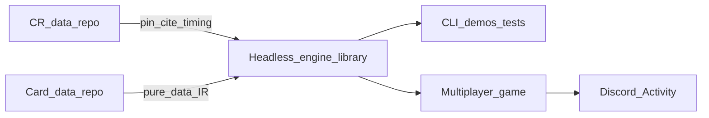

# Netrunner Project Roadmap

*Updated 2026-11-12. Current versions are in the [pin table](../README.md). Corpus idle. Fidelity program phases 1–5 done; standardization S0–S6 landed. Product Phase 5 is met: the verification table and `/play/` share a match protocol, and a restart replays the applied-intent log. Next is a Discord Activity. The public host is one Lightsail instance. Discord is the account and the conversation.*

## North star

Two locked goals, in parallel:

1. **Data-driven stack.** A headless **engine library** plus **cards as pure data**, grounded in pinned Comprehensive Rules. [netrunner-game](https://github.com/nhoople/netrunner-game) is the multiplayer game. Today it is a local two-seat table that verifies the engine. The product shell is a Discord Activity, and that table stays a test harness.
2. **Full executable CR fidelity** for procedures the corpus needs — conditionals pending at **10.3.1a** (or observably identical), real **9.9** / **9.10** / **9.9.9** behavior, and Eternal **9.12** subtype chains only when Eternal is intentional.

This stack is **not** a Comprehensive Rules prose or `nodes.json` compiler. Card text wins on direct contradiction (**CR 1.2.1**). Product Phases 0–8 below are the build arc (engine → corpus → table → Discord). The **Engine CR fidelity** program is a separate numbered track; do not confuse the two.

**Design principles (locked):**

- **Cards are pure data.** Card text becomes structured payloads (stats, subtypes, abilities as Effect IR). Host code does not special-case individual cards once the IR covers them.
- **Engine is a headless library.** TypeScript rules core stays UI- and network-agnostic; CLI/demos are development hosts only.
- **CR data is authority for citations and timing IDs**, not executable card behavior. Keep pinning [netrunner-comprehensive-rules-data](https://github.com/nhoople/netrunner-comprehensive-rules-data) (tag `v26.03` today).
- **CR terminology** for the stack lives in [`cr-glossary.md`](https://github.com/nhoople/netrunner-engine/blob/master/docs/cr-glossary.md) and [`cr-term-map.json`](https://github.com/nhoople/netrunner-engine/blob/master/data/cr-term-map.json) (full `terms.json` inventory + denylist). Card printings are not rewritten (**CR 1.2.1**).
- **CR adherence gate for new clears.** Card-text → Effect IR + engine tests are necessary but not sufficient; each slice must also pass the checklist in [`cr-adherence-gate.md`](https://github.com/nhoople/netrunner-engine/blob/master/docs/cr-adherence-gate.md) (timing windows, defined terms, cannot/prevent, cite recording, fail-closed). PR templates in engine + cards-data require the gate recording section for IR/clear slices.
- **Stable host API.** Export pure functions (`createGame`, `queryLegality`, `applyIntent`, side-filtered views). `netrunner-game` consumes them by release tag. The engine stays UI- and network-agnostic; multiplayer lives in the game repo.
- **Grow IR and mechanics together.** Expand Effect IR and core CR procedures in lockstep with the card set that needs them—no big-bang “compile all of NRDB.”
- **Compose Effect IR.** Card JSON uses `op` and `kind`. The source of truth is `Effect` and `KNOWN_PRIMITIVE_KINDS` in `netrunner-engine/src/effects/ir.ts`. Forms are `seq`, `do`, `if`, `prevent`, and `choose`. Compose with those before adding a primitive. Add a primitive when the same behavior is on many cards and a composition is unclear or fragile. A one-off stays composed on the card. Timing-sensitive procedure stays in the engine. A trace nests effects: `{ kind: "trace", strength, onSuccess, onFailure? }`. Unimplemented printed text goes in `unsupported`. Someone writing a card needs the current card JSON, the relevant Comprehensive Rules nodes, and a test. A kind is snake_case and names the procedure (verb, then object). Pack codes and card titles are not prefixes. The check is `primitiveNameFollowsStandard` in `netrunner-engine/src/effects/primitiveNames.ts`.
- **The host is authoritative.** `netrunner-game` applies an intent only when the engine accepts it. The applied-intent list is the match history. Replay, golden transcripts, and later spectators read that list.
- **The table sends a full seat snapshot.** Each seat receives everything the Comprehensive Rules allow that seat to see. The Activity uses that same snapshot. While a connection stays up, further updates are the newly applied intents. A reconnect sends the current snapshot. When both players allow spectators, that feed is delayed in every play style. The verification table's spectator link stays the live public view.
- **Later product work follows a measured need.** Challenge comes first, then one casual Play queue, then Ranked. Tournaments, AI opponents, and a native Android client wait. Every way a match starts begins with a format, a deck, and whether to allow spectators. A format checks that format's card pool and restriction list. Learn to play's deck is its Corp or Runner teaching list. Caching or incremental `queryLegality` waits until a timing readout shows that path is slow.

## Current baseline

| Layer | Status |
|-------|--------|
| Project status | Corpus **idle** — Magnum Opus complete (**8/8**; `mor` absorbed). FFG Core-forward + Gateway→VP + MO supported. Eternal/RAM unique-title gaps closed. `tdc` deferred; skip `napd`/draft/championship. The verification table and `/play/` are in `netrunner-game`. Next is a Discord Activity |
| CR dataset | Consumer JSON pipeline live; pin **`v26.03`** (do not invent a bump) |
| Cards-as-data | [netrunner-cards-data](https://github.com/nhoople/netrunner-cards-data) — full FFG Core-forward + Gateway→VP + Magnum Opus; (side and type, `deckLimit`, printings, printed sentences, verified rulings, and format lists). Title corpus unchanged from `v1.147.6`. Verbal Plasticity and Jinteki: Restoring Humanity declare their printed abilities |
| Engine | [netrunner-engine](https://github.com/nhoople/netrunner-engine) — pins cards by release tag and loads files by side and type. Play, paid, and subroutine text is the ability record. The effect switch is split by procedure |
| Game | [netrunner-game](https://github.com/nhoople/netrunner-game) — the multiplayer game. Verification table, product client at `/play/`, and a restart that replays the applied-intent log. Pins engine, cards, and CR by release tag |
| Corpus | **68/68** waves in `pool.json` are `supported`. Outside that list: skip `napd`, draft, and championship; defer `tdc`; `sm` is reprints only |
| Formats | NSG **Core Sets**, **Standard**, **Startup**, **Eternal**, and **RAM** are covered for unique-title play ([`format-coverage-audit.md`](format-coverage-audit.md)). Challenge and Play offer Learn to play, Core Sets, Startup, Standard, and Eternal. Ranked offers those four formats. System Gateway is a set, not a choice. Ban lists are in cards **`v1.147.19`**. The host checks the list in force when a format match starts (Phase 6). The verification table does not |
| Releases | Set-complete paired tags; engine maintenance releases when `src/` changes (game + meta pins in the same pass); test-only merges with no tag ([`git-hygiene.md`](git-hygiene.md)) |
| CI | Engine: lint + typecheck + test; cards-data: validate; rules-data: transform + test + validate; game: typecheck + test + pin check ([`git-hygiene.md`](git-hygiene.md)) |
| Confidence extras | Engine [#193](https://github.com/nhoople/netrunner-engine/pull/193) — interaction smoke, cross-pack, cannot-sweep, goldens, fail-closed (merged) |
| Multiplayer | Product Phase 5 is met. The verification table and `/play/` share a match protocol. A restart replays the applied-intent log. Next is Phase 6, a Discord Activity on one Lightsail instance |
| Engine fidelity | Program phases **1–5 done** at **`v1.147.222`**. Standardization S0–S6 done — see [Engine standardization](#engine-standardization). Next engine track: the [CR audit and procedure standardization program](#cr-audit-and-procedure-standardization). |
| Active work | **Engine:** the [CR audit and standardization program](plans/cr-audit-standardization-program.md). **Product:** Discord Activity, still in `netrunner-game`. It starts at that program's [Phase 6 gate](plans/cr-audit-standardization-program.md#phase-6-gate) and opens with Learn to play and Startup. **Product UI:** the [product UI plan](plans/product-ui.md) makes `/play/` playable; it runs beside the audit and does not wait for the gate. **Test table:** the [verification table plan](plans/verification-table.md) makes checking one card fast. The verification table stays a test harness. Framework migration M1–M6 landed on engine floor. Corpus idle until the next NSG pack or a CR bump |

## Engine CR fidelity

Adopted 2026-10-29. Full **executable** CR fidelity for the corpus, still without compiling CR prose or `nodes.json`. Card text wins (**CR 1.2.1**). Detail lives in the plans in `docs/plans/`; this section is the project-facing status.

| Program phase | Goal | Status |
|---------------|------|--------|
| 1 | **9.3** records-only runtime (cut dual-path `on*` mark/fire surface) | **Done** |
| 2 | Declarative trigger predicates over `CheckpointFacts` / `CheckpointDiff` | **Done** |
| 3 | Universal **10.3.1a** mark path (note→checkpoint→mark / predicates); remove immediate hook fires | **Done** — engine **`v1.147.216`** (`fireStoredConditionals` removed; play marks at **8.6.7e**, resolves at **8.6.7f**) |
| 4 | Replacement layer beyond Gebrselassie (**9.9.9**) | **Done** — duration class; general **9.9.9b/c** API (`v1.147.219`); System Seizure strength-increase interrupt (`v1.147.220`) |
| 5 | Eternal **9.12** gained-subtype→further-grant chains | **Done** via standardization **S1** |

Phase-3 leftovers closed at **`v1.147.221`** (Jeitinho bypass note path; `fireInlineConditional` removed).

**Plans:** [`full-cr-fidelity-program.md`](plans/done/full-cr-fidelity-program.md) (fidelity); [`engine-standardization-program.md`](plans/done/engine-standardization-program.md) (standardization); [`cr-audit-standardization-program.md`](plans/cr-audit-standardization-program.md) (CR audit and procedure standardization, next engine track); [`stack-tracking-assessment.md`](plans/done/stack-tracking-assessment.md) (status). Product Phase 5 is met. Phase 6 is the Discord Activity.

## Engine standardization

Maximal program: grow the practical **9.12** blanking solver into a continuous-characteristics layer; finish **9.10** lingering single-write; standardize mid-hook choices and seat visibility. Inventory: [`engine-standardization-inventory.md`](plans/done/engine-standardization-inventory.md).

| Phase | Goal | Status |
|-------|------|--------|
| S0 | Charter + inventory | **Done** |
| S1 | Continuous subtypes (MG / Egret / Fatuma gained→further) | **Done** |
| S2 | Gained subs / strength / cost continuous mods | **Done** at **`v1.147.222`**. Strength is lingering-only; gained subs are declarations (`v1.147.239`) |
| S3 | Lingering single-write | **Done** at **`v1.147.222`**. The mark, blanks, and end-of-turn subtype grants each have one reader (`v1.147.239`) |
| S4 | Graph mid-hook may/choose helper | **Done** (`openPendingChoose`; Security Nexus) |
| S5 | Seat visibility module | **Partly done.** `seatVisibility.ts` exists, but it cites CR 1.18 (Advancing Cards) where visibility is CR 1.21. `getPublicView` copies the run and pending state unfiltered, and the game builds spectator views separately. CR audit area 4 finishes it |
| S6 | Static continuous declarations | **Done for subtype grants and gained subroutines** (`continuousSubtypeGrants`, `continuousGainedSubDecls`). Other card behavior is still 616 boolean card flags, and a flag can hide a procedure from a search of card JSON (Tāo Salonga) |

## CR audit and procedure standardization

Adopted 2026-11-11. The fidelity and standardization programs covered timing and continuous effects. They did not cover how cards move between zones. Many cards carry their own copy of install, trash, host, swap, rez, or run-position code, and those copies skip parts of the CR. This program builds tools that find those violations across the engine, routes each procedure through one shared helper, and adds guardrails against new copies. Plan: [`cr-audit-standardization-program.md`](plans/cr-audit-standardization-program.md). The Discord Activity starts at its [Phase 6 gate](plans/cr-audit-standardization-program.md#phase-6-gate).

| Phase | Goal | Status |
|-------|------|--------|
| 0 | Docs: cr-checker reads printed text, known gaps recorded | **Done** |
| 1 | Verification tools (invariants, playouts, sweeps, visibility fuzz, mutation testing) | Next |
| 2 | Guardrails on direct state writes and kind coverage | — |
| 3 | Ten areas ordered by risk: nine procedures, then card flags and declarations | — |

**Known gaps** at engine `v1.147.251` (each fixed by the area named):

- **Off-Campus Apartment and other hosts (area 1).** Trashing a host moves its hosted Runner cards to the heap but leaves them in `runner.installed`. Their trash triggers don't run. The 10.3.1g checkpoint can't see them.
- **Mandatory Seed Replacement (area 2).** It empties every server's ice list before the Corp rearranges. While the choices are open, the ice belongs to no server, so a checkpoint in that window could delete a remote that has only ice. Sunset and Mandatory Seed also have no run guard.
- **Tāo Salonga: Telepresence Magician (area 3).** The swap after an agenda is scored or stolen does nothing. Every option of `swap_two_ice` gains 0 credits.

## Product phase map

Historical build arc for the stack and multiplayer host. Numbering here is **not** the fidelity program above.

### Phase 0 — Foundations (done)

- Maintain CR ingest/validate/pin when Null Signal publishes new CR versions (checklist: [`cr-pin-bump-checklist.md`](https://github.com/nhoople/netrunner-engine/blob/master/docs/cr-pin-bump-checklist.md)).
- Keep engine `npm run fetch-cr` + cite/timing-id tests green (default CI `npm test`: `tests/cr-cite-map.test.ts`, timing `stepId` check in `tests/engine.test.ts`).

**Exit:** CR pin story and engine harness remain the source of rules citations.

### Phase 1 — Engine library core (done)

Headless engine with a **scripted two-player game** via the library API (CLI/tests as hosts).

**Library API shape:** pure functions only—e.g. `createGame`, `queryLegality`, `applyIntent`, `getPublicView(side)`—no sockets, HTTP, or UI in the engine package.

**Exit:** Integration tests for a full short game on Gateway/SU21 cards; public library API documented in engine README. *(met)*

### Phase 2 — Card data model + IR expansion (done)

- Card JSON in [netrunner-cards-data](https://github.com/nhoople/netrunner-cards-data); engine pins via `data/cards-pin.json` + `npm run fetch-cards`.
- Effect IR is the executable language; expand primitives when real cards require them. Fail closed on unknown IR nodes.

**Exit:** Demos/tests pass from data-loaded cards; new simple ice/breaker is a data change. *(met)*

### Phase 3 — Card corpus (FFG Core-forward + Magnum Opus **COMPLETE**)

Supported subset in release order, each wave gated by IR/engine support; unsupported clauses marked explicitly.

**Floor today:** see the [pin table](../README.md). Cards are stored by side and type. Printed link, deck size, influence limit, and influence cost are stored. Ice install cost is 1 credit for each piece of ice already protecting the server (CR 1.16.6b). Assets, agendas, and upgrades install for free (CR 8.5.11a). Each printed ability is a Comprehensive Rules 9.3 record. Play, paid, and subroutine text is that record. CR pin **`v26.03`**. `netrunner-game` pins those three tags.

**Supported:** all **68** waves in [`data/pool.json`](https://github.com/nhoople/netrunner-cards-data/blob/v1.147.22/data/pool.json) `corpusOrder` are `supported`. That is FFG Core through Kitara, Reign and Reverie, Magnum Opus (`mo` 8/8, `mor` absorbed), System Core 2019, Downfall, Uprising, and Gateway through Vantage Point. Per-wave milestone tags are on the cards and engine GitHub Releases.

**Not in the corpus:**

| Item | Policy |
|------|--------|
| NAPD (`napd`) | Skip. Absent from the NSG Eternal set list. One NRDB-only identity, Cyber Bureau. |
| Draft | Skip. |
| Championship | Skip. |
| Terminal Directive campaign (`tdc`) | Deferred. The Terminal Directive card pack (`td`) is supported. |
| Salvaged Memories (`sm`) | Outside the corpus. Every card is a reprint, so it adds no new titles. |

**Formats:** NSG Netrunner Core Sets, Standard, Startup, Eternal, and Random Access Memories are covered for unique-title play. Ban lists are in cards `v1.147.19`. Phase 6 checks the list in force when a match starts. The verification table does not. Random Access Memories stays in this coverage and is not a play format. System Gateway is a set inside Core Sets, not a play format. Learn to play is the fixed Gateway teaching lists, offered beside the formats in Phase 6. The pack-by-pack check is [`format-coverage-audit.md`](format-coverage-audit.md).

**Tooling:** Pack extracts in cards-data originate from pinned NSG [netrunner-cards-json](https://github.com/Null-Signal-Games/netrunner-cards-json) (`data/nsg-catalog-pin.json`). NSG is source of truth; NRDB is downstream. `python3 scripts/nsg_catalog.py check` in cards-data compares that pin with current `main` and reports a pack outside the corpus, or a change to faction, cost, strength, or printed text in a corpus pack. It does not edit card files. Today it does not look at `v2/formats/` or `v2/restrictions/`. It gains that report, so a balance update shows up the way a printed-text change does. The report can land before the Activity, and it does not by itself cut a release.

Do not start a later set until the current release’s cards pass (fully supported or explicitly deferred with `unsupported` notes) **and** the CR adherence gate for cleared cards is satisfied (or residual debt is explicit).

**Per-slice (every IR clear, not only set-complete):** follow [`cr-adherence-gate.md`](https://github.com/nhoople/netrunner-engine/blob/master/docs/cr-adherence-gate.md) — timing windows, defined terms/keywords, cannot/prevent, install/rez/run touches, cite recording against pin `v26.03`, fail-closed when CR is ambiguous or the engine window is missing. Slice work lands as PR merges. If the engine PR changes `src/` and the game should pick it up, cut an engine maintenance release and bump game + meta pins ([`git-hygiene.md`](git-hygiene.md)); test-only slices merge with no tag.

**Exit:** Declared supported pool with engine tests and a CR gate summary on the set-complete PR. Refresh the floor in this roadmap.

### Set complete checklist (each pack wave)

The checklist is in [`git-hygiene.md`](git-hygiene.md#set-complete-checklist), with the release policy.

### Phase 4 — Host polish (done)

CLI/demos and docs that exercise the library API; keep pin/fetch story clear for consumers.

**Landed (engine [#186](https://github.com/nhoople/netrunner-engine/pull/186), cards [#161](https://github.com/nhoople/netrunner-cards-data/pull/161)):** engine CLI hosts call `createGame` / `queryLegality` / `applyIntent` / `getPublicView` (`npm run demo:library`, `npm run cli:help`); README pin/fetch + API shape clarified; cards-data examples track current pairing tag. Those CLI hosts stay development tools.

**Lint / typecheck (engine [#189](https://github.com/nhoople/netrunner-engine/pull/189)):** `npm run lint` (eslint recommended + typescript-eslint) and `npm run typecheck` (`tsc --noEmit`) are CI hard-fails alongside `npm test`. No Prettier; cards-data lint not in scope.

**Exit:** Consumers can run the library from the documented CLI and pin story. *(met)* The multiplayer client is Phase 5.

### Phase 5 — Local table (done)

[netrunner-game](https://github.com/nhoople/netrunner-game) verifies the pinned engine in the browser. Corp, Runner, and spectator each see what the Comprehensive Rules allow that seat to see. The plain table stays a direct view of the match snapshot. It remains the test harness. The product client uses the same match protocol and moves into the Discord Activity.

**Exit:** met. The verification table and the product client at `/play/` speak the same match protocol.

What Phase 5 built, in detail: [`plans/done/local-table.md`](plans/done/local-table.md).

### Phase 6 — Discord Activity (next)

The product is a Discord Activity on one Lightsail host. Discord is the account and the only player conversation. Account checks the Discord user. Matchmaking checks the format and deals through a game container. That container sends only that seat's snapshot. The engine never sees a Discord user. A restart replays the applied-intent log, and matchmaking returns the same Discord user to the same seat.

**Start:** Phase 6 begins at the [Phase 6 gate](plans/cr-audit-standardization-program.md#phase-6-gate) of the CR audit program: its tools and guards are in, areas 1–4 (through visibility) are done, and the playouts and visibility fuzz run clean. The first matches offer Learn to play and Startup. Core Sets, Standard, and Eternal open as each pool passes the same two checks.

**Exit:** Two Discord users play a match in an Activity. Each sees only their seat. Talk is Discord. A restart returns the same Discord user to the same seat. Challenge deals a format-checked match.

The design (hosting, security, decks, formats, spectators, ban lists, challenges): [`plans/discord-activity.md`](plans/discord-activity.md).

### Phase 7 — Play queue

One casual queue. A player enters with a format, a deck, and a spectator choice. The host pairs two Discord users who chose the same format and opposite sides, and the same starter or expanded list when the format is Learn to play. A matched pair gets a Discord channel or thread for that match. The match protocol is Phase 6, including the delayed spectator feed when both allowed it. The format check runs again when the match is dealt.

**Exit:** Two queued users in the same format are seated, and their conversation is that match's Discord channel or thread.

### Phase 8 — Ranked

The Play queue, plus a rating. The choices are Core Sets, Startup, Standard, and Eternal. Each player still chooses a deck and whether to allow spectators before queueing. The same restriction list applies. Spectators, when both allow them, use the same delayed feed as every other play style.

**Exit:** A rated pair is seated under the format and decks they chose.

## Out of scope

- Compiling CR prose, `nodes.json`, or NRDB HTML into executable rules without hand-authored IR.
- UI, networking, matchmaking, or Discord identity inside the engine. The game host owns those. Discord is the account.
- A homegrown login, a product chat, or local play as a product. The verification table stays a test harness.
- Random Access Memories or System Gateway as a play format. System Gateway is a set inside Core Sets.
- Running the engine as its own network service, or serving card and rules data from a cache outside the match process.
- A GameLift fleet, a Kubernetes cluster, or Redis as the record of decks and matches. The first public host is the one Lightsail instance above. Postgres holds the account and matchmaking records.
- A structural diff of internal game state as the client protocol.
- Compiling every continuous interaction from CR prose. The practical continuous layer (blanking, subtypes, Fatuma/Wetwork collectors) is hand-authored IR + solvers — not a prose/`nodes.json` compiler.
