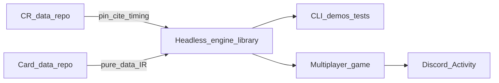

# Netrunner Project Roadmap

*The one overall plan. Settled in a grill with Nathaniel on 2026-11-27; see [Decisions](#decisions). Current versions are in the [pin table](../README.md). The detail of finished work (product Phases 0–5, the fidelity and standardization programs) is in [`history.md`](history.md#notes-moved-from-the-roadmap).*

## Where it stands

**Status:** active. Updated 2026-11-27.

The engine, the whole card pool up to Eternal, and a local table that plays a full match are done. The [repository layout plan](plans/repo-layout.md) is running. The [CR audit](plans/cr-audit-standardization-program.md) is paused until the layout plan's slice X merges. Then the playable board, then Discord. There is no date: version 1 ships when it meets the bar below.

## Waiting on you

Nothing.

## The goal

A free, public place for anyone to play Netrunner inside Discord, with rules as correct as the Comprehensive Rules (CR) make them.

Correctness is a goal of its own, not only a means to the product. Before anyone plays, every card in the supported pool plays as its text says, no seat sees what the CR hides from it, and the whole [CR audit program](plans/cr-audit-standardization-program.md) is done. A rule with two readings is looked into until it is settled, not picked to move on.

## Version 1

Version 1 is done when players can play friends and strangers in Discord:

1. **Play against friends.** Two Discord users play a match in the Activity by Challenge. Each sees only their seat. A restart returns each user to the same seat. This ships first, to the players Nathaniel knows, so real matches find the rough edges while the audience is small. Design: [`plans/discord-activity.md`](plans/discord-activity.md).
2. **The casual queue.** A player enters with a format, a deck, and a spectator choice, and is paired with someone on the other side. This completes version 1, and that is when it is announced publicly.

Challenge offers Learn to play, Core Sets, Startup, Standard, and Eternal, all at once. Eternal is the widest pool supported. Which of them the queue offers is [not yet decided](#not-yet-decided).

**Bug reports.** A "Report a problem" button in the game saves the match up to that moment (the applied-intent list) with one line from the player. Reports are stored privately on the host, because a saved match holds both seats' hidden cards (CR 10.2.2a). An agent replays each report, files it with the hidden details left out, and fixes a supported card that plays wrong at once (the fix-now rule in [`how-we-work.md`](how-we-work.md#findings)). Nathaniel is asked only when a fix needs a decision. The button ships with play against friends.

**New card sets.** Once people play, each new Null Signal Games set is supported before new features, so Standard stays current. See [New card sets](#new-card-sets).

**Free.** No ads, no payments, a fan project. Nathaniel runs the one public host and pays for it. The engine and the game use the MIT license. The two data repos say where their data comes from and that its rights stay with its owners.

## Order of work

One plan at a time:

1. [Repository layout](plans/repo-layout.md), through slice X.
2. The whole [CR audit and standardization program](plans/cr-audit-standardization-program.md), through its [Phase 6 gate](plans/cr-audit-standardization-program.md#phase-6-gate).
3. The [product UI](plans/product-ui.md): `/play/` playable from the board.
4. The [Discord Activity](plans/discord-activity.md): play against friends, with the report button.
5. The casual queue. Its plan is written and grilled when step 4 is done.

Fix-now slices ([`how-we-work.md`](how-we-work.md#findings)) can go ahead of the current step.

## After version 1

Each waits until version 1 ships and players show a need for it:

- **Ranked:** the casual queue plus a rating, in Core Sets, Startup, Standard, and Eternal.
- Tournaments.
- AI opponents.
- A native phone app.
- A second board layout.
- A project Discord server or channel for players.

## Design principles

- **Cards are pure data.** Card text becomes structured payloads (stats, subtypes, abilities as Effect IR). Host code does not special-case individual cards once the IR covers them.
- **Engine is a headless library.** TypeScript rules core stays UI- and network-agnostic; CLI/demos are development hosts only.
- **CR data is authority for citations and timing IDs**, not executable card behavior. Keep pinning [netrunner-comprehensive-rules-data](https://github.com/nhoople/netrunner-comprehensive-rules-data) (tag `v26.03` today). Card text wins on direct contradiction (**CR 1.2.1**). This stack is not a compiler of CR prose or `nodes.json`.
- **CR terminology** for the stack lives in [`cr-glossary.md`](https://github.com/nhoople/netrunner-engine/blob/master/docs/cr-glossary.md) and [`cr-term-map.json`](https://github.com/nhoople/netrunner-engine/blob/master/data/cr-term-map.json) (full `terms.json` inventory + denylist). Card printings are not rewritten (**CR 1.2.1**).
- **CR adherence gate for new clears.** Card-text → Effect IR + engine tests are necessary but not sufficient; each slice must also pass the checklist in [`cr-adherence-gate.md`](https://github.com/nhoople/netrunner-engine/blob/master/docs/cr-adherence-gate.md) (timing windows, defined terms, cannot/prevent, cite recording, fail-closed). PR templates in engine + cards-data require the gate recording section for IR/clear slices.
- **Stable host API.** Export pure functions (`createGame`, `queryLegality`, `applyIntent`, side-filtered views). `netrunner-game` consumes them by release tag. The engine stays UI- and network-agnostic; multiplayer lives in the game repo.
- **Grow IR and mechanics together.** Expand Effect IR and core CR procedures in lockstep with the card set that needs them—no big-bang “compile all of NRDB.”
- **Compose Effect IR.** Card JSON uses `op` and `kind`. The source of truth is `Effect` and `KNOWN_PRIMITIVE_KINDS` in `netrunner-engine/src/effects/ir.ts`. Forms are `seq`, `do`, `if`, `prevent`, and `choose`. Compose with those before adding a primitive. Add a primitive when the same behavior is on many cards and a composition is unclear or fragile. A one-off stays composed on the card. Timing-sensitive procedure stays in the engine. A trace nests effects: `{ kind: "trace", strength, onSuccess, onFailure? }`. Unimplemented printed text goes in `unsupported`. Someone writing a card needs the current card JSON, the relevant Comprehensive Rules nodes, and a test. A kind is snake_case and names the procedure (verb, then object). Pack codes and card titles are not prefixes. The check is `primitiveNameFollowsStandard` in `netrunner-engine/src/effects/primitiveNames.ts`.
- **The host is authoritative.** `netrunner-game` applies an intent only when the engine accepts it. The applied-intent list is the match history. Replay, golden transcripts, bug reports, and spectators read that list.
- **The table sends a full seat snapshot.** Each seat receives everything the Comprehensive Rules allow that seat to see. The Activity uses that same snapshot. While a connection stays up, further updates are the newly applied intents. A reconnect sends the current snapshot. When both players allow spectators, that feed is delayed in every play style. The verification table's spectator link stays the live public view.
- **Every match starts the same way.** A player chooses a format, a deck, and whether to allow spectators. A format checks that format's card pool and restriction list. Learn to play's deck is its Corp or Runner teaching list. Caching or incremental `queryLegality` waits until a timing readout shows that path is slow.

## Current baseline

| Layer | Status |
|-------|--------|
| CR dataset | Consumer JSON pipeline live; pin **`v26.03`** (do not invent a bump) |
| Cards-as-data | [netrunner-cards-data](https://github.com/nhoople/netrunner-cards-data): full FFG Core-forward, Gateway through Vantage Point, and Magnum Opus (side and type, `deckLimit`, printings, printed sentences, verified rulings, and format lists) |
| Engine | [netrunner-engine](https://github.com/nhoople/netrunner-engine): pins cards by release tag and loads files by side and type. Play, paid, and subroutine text is the ability record. Fidelity phases 1–5 and standardization S0–S6 are done ([history](history.md#notes-moved-from-the-roadmap)) |
| Game | [netrunner-game](https://github.com/nhoople/netrunner-game): the verification table (a test harness), the product client at `/play/`, and a restart that replays the applied-intent log. Pins engine, cards, and CR by release tag |
| Corpus | **68/68** waves in `pool.json` are `supported`. Idle until the next Null Signal set |
| Formats | Core Sets, Startup, Standard, and Eternal are covered for unique-title play ([`format-coverage-audit.md`](format-coverage-audit.md)), plus Learn to play. Ban lists are in cards **`v1.147.19`**. The host checks the list in force when a format match starts; the verification table does not |
| Releases | Set-complete paired tags; engine maintenance releases when `src/` changes (game + meta pins in the same pass); test-only merges with no tag ([`git-hygiene.md`](git-hygiene.md)) |
| CI | Engine: lint + typecheck + test; cards-data: validate; rules-data: transform + test + validate; game: typecheck + test + pin check ([`git-hygiene.md`](git-hygiene.md)) |

## New card sets

Null Signal Games (NSG) is the source of truth; NetrunnerDB is downstream. Card extracts in cards-data come from a pinned [netrunner-cards-json](https://github.com/Null-Signal-Games/netrunner-cards-json) (`data/nsg-catalog-pin.json`). `python3 scripts/nsg_catalog.py check` in cards-data compares that pin with NSG's current `main` and reports a new pack, or a change to faction, cost, strength, or printed text in a supported pack. It does not edit card files. It gains a report on `v2/formats/` and `v2/restrictions/`, so a balance update shows up the way a printed-text change does.

A new set is done when its cards pass (fully supported, or deferred with `unsupported` notes), every cleared card passes the [CR adherence gate](https://github.com/nhoople/netrunner-engine/blob/master/docs/cr-adherence-gate.md), and the [set complete checklist](git-hygiene.md#set-complete-checklist) is met. Do not start a later set before that.

Not in the corpus:

| Item | Policy |
|------|--------|
| NAPD (`napd`) | Skip. Absent from the NSG Eternal set list. One NRDB-only identity, Cyber Bureau |
| Draft | Skip |
| Championship | Skip |
| Terminal Directive campaign (`tdc`) | Deferred. The Terminal Directive card pack (`td`) is supported |
| Salvaged Memories (`sm`) | Outside the corpus. Every card is a reprint, so it adds no new titles |

## Product phases

| Phase | What | Status |
|---|---|---|
| 0 | Foundations: the CR pin and the engine harness | Done |
| 1 | Engine library core | Done |
| 2 | Card data model and IR | Done |
| 3 | Card corpus: FFG Core-forward, Gateway through Vantage Point, Magnum Opus | Done; [new sets](#new-card-sets) continue |
| 4 | Host polish: CLI and library docs | Done |
| 5 | Local table | Done |
| 6 | Discord Activity: play against friends ([plan](plans/discord-activity.md)) | Next, after the board |
| 7 | The casual queue | Version 1 |
| 8 | Ranked | After version 1 |

Phase 7: one casual queue. A player enters with a format, a deck, and a spectator choice. The host pairs two Discord users who chose the same format and opposite sides, and the same starter or expanded list when the format is Learn to play. The format check runs again when the match is dealt. Spectators, when both allow them, use the delayed feed from Phase 6.

Phase 8: the queue plus a rating, in Core Sets, Startup, Standard, and Eternal. The same restriction list and spectator rules apply.

## Decisions

| Date | Decision | Reason |
|---|---|---|
| 2026-11-27 | The product is public: anyone may play | Every phase so far was built toward it |
| 2026-11-27 | No date. Version 1 ships when it meets its bar | The bar is correctness; progress shows on the plan status page |
| 2026-11-27 | Correctness is a goal of its own. The whole CR audit finishes before anyone plays, and a rule with two readings is settled, not picked | Nathaniel's call. Confirms the CR audit's 2026-11-19 gate |
| 2026-11-27 | Version 1 is play against friends plus the casual queue. Ranked and tournaments come after | A public product needs a way to meet strangers; a rating does not |
| 2026-11-27 | Play against friends ships first; the casual queue completes version 1 and is the public announcement | Friends' matches find the rough edges while the audience is small |
| 2026-11-27 | Once players play, each new NSG set is supported before new features | A public Standard that is out of date is not Standard |
| 2026-11-27 | Free, as free as can be: no ads or payments. Nathaniel runs and pays for the one public host | A fan project; NSG's community favors non-commercial ones |
| 2026-11-27 | MIT license for the engine and the game. The data repos get a notice that their data's rights stay with its owners | All five repos are public with no license, which lets no one reuse the code. Card and rules text is not Nathaniel's to license |
| 2026-11-27 | Random Access Memories is dropped as a covered format. The widest pool is Eternal | Every card in its pool is already in Eternal, so no card is lost |
| 2026-11-27 | Tournaments, AI opponents, a phone app, and a second board layout wait until after version 1 | None is needed for two people to play |
| 2026-11-27 | One plan at a time: layout, the whole CR audit, the board, play against friends, the casual queue | Nathaniel's 2026-11-23 order, confirmed |
| 2026-11-27 | Players report problems with a "Report a problem" button that saves the match with one line of text. No project Discord server for now | The saved match lets an agent replay the bug; the button reaches players who would never write a report |
| 2026-11-27 | Reports are stored privately on the host; an agent files each without hidden details | A saved match holds both seats' hidden cards (CR 10.2.2a) |
| 2026-11-27 | Agents handle reports under the fix-now rule; Nathaniel is asked only when a fix needs a decision | The existing findings rule, applied to players |
| 2026-11-27 | The report button ships with play against friends | The first problems turn up in friends' matches |
| 2026-11-27 | The roadmap is the one overall plan; the detail of finished phases moved to `history.md` | It reads in a minute |

## Not yet decided

- **Which formats the casual queue offers.** Five formats may split a small player base so the queue sits empty. Blocks: the casual queue's plan.
- **Whether a player hears back when their report is fixed.** For example, a Discord message. Blocks: slicing the [Discord Activity plan](plans/discord-activity.md).
- **A project Discord server or channel for players.** Not for now; revisit when the queue opens. Blocks: nothing yet.

## Out of scope

- Compiling CR prose, `nodes.json`, or NRDB HTML into executable rules without hand-authored IR, including every continuous interaction. The practical continuous layer (blanking, subtypes, Fatuma/Wetwork collectors) is hand-authored IR plus solvers.
- UI, networking, matchmaking, or Discord identity inside the engine. The game host owns those. Discord is the account.
- A homegrown login, a product chat, or local play as a product. The verification table stays a test harness.
- Random Access Memories or System Gateway as a play format, and any pool wider than Eternal. System Gateway is a set inside Core Sets.
- Ads, payments, or any paid tier.
- Running the engine as its own network service, or serving card and rules data from a cache outside the match process.
- A GameLift fleet, a Kubernetes cluster, or Redis as the record of decks and matches. The first public host is one Lightsail instance. Postgres holds the account and matchmaking records.
- A structural diff of internal game state as the client protocol.
