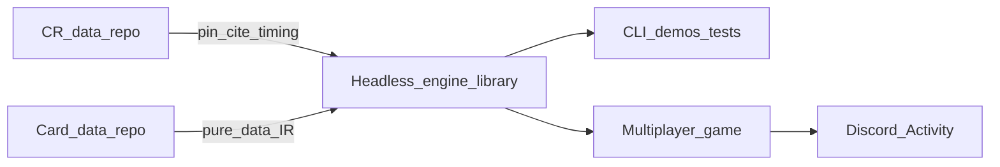
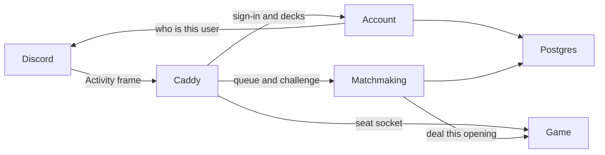

# Netrunner Project Roadmap

*Updated 2026-11-11. Current versions are in the [pin table](../README.md). Corpus idle. Fidelity program phases 1–5 done; standardization S0–S6 landed. Product Phase 5 is met: the verification table and `/play/` share a match protocol, and a restart replays the applied-intent log. Next is a Discord Activity. The public host is one Lightsail instance. Discord is the account and the conversation.*

## North star

Two locked goals, in parallel:

1. **Data-driven stack.** A headless **engine library** plus **cards as pure data**, grounded in pinned Comprehensive Rules. [netrunner-game](https://github.com/nhoople/netrunner-game) is the multiplayer game. Today it is a local two-seat table that verifies the engine. The product shell is a Discord Activity, and that table stays a test harness.
2. **Full executable CR fidelity** for procedures the corpus needs — conditionals pending at **10.3.1a** (or observably identical), real **9.9** / **9.10** / **9.9.9** behavior, and Eternal **9.12** subtype chains only when Eternal is intentional.

This stack is **not** a Comprehensive Rules prose or `nodes.json` compiler. Card text wins on direct contradiction (**CR 1.2.1**). Product Phases 0–8 below are the build arc (engine → corpus → table → Discord). The **Engine CR fidelity** program is a separate numbered track; do not confuse the two.

**Design principles (locked):**

- **Cards are pure data.** Card text becomes structured payloads (stats, subtypes, abilities as Effect IR). Host code does not special-case individual cards once the IR covers them.
- **Engine is a headless library.** TypeScript rules core stays UI- and network-agnostic; CLI/demos are development hosts only.
- **CR data is authority for citations and timing IDs**, not executable card behavior. Keep pinning [netrunner-comprehensive-rules-data](https://github.com/nhoople/netrunner-comprehensive-rules-data) (tag `v26.03` today).
- **CR terminology** for the stack lives in [`cr-glossary.md`](https://github.com/nhoople/netrunner-engine/blob/master/docs/cr-glossary.md) and [`cr-term-map.json`](https://github.com/nhoople/netrunner-engine/blob/master/data/cr-term-map.json) (full `terms.json` inventory + denylist). Card printings are not rewritten (**CR 1.2.1**).
- **CR adherence gate for new clears.** Card-text → Effect IR + engine tests are necessary but not sufficient; each slice must also pass the checklist in [`cr-adherence-gate.md`](https://github.com/nhoople/netrunner-engine/blob/master/docs/cr-adherence-gate.md) (timing windows, defined terms, cannot/prevent, cite recording, fail-closed). PR templates in engine + cards-data require the gate recording section for IR/clear slices.
- **Stable host API.** Export pure functions (`createGame`, `queryLegality`, `applyIntent`, side-filtered views). `netrunner-game` consumes them by release tag. The engine stays UI- and network-agnostic; multiplayer lives in the game repo.
- **Grow IR and mechanics together.** Expand Effect IR and core CR procedures in lockstep with the card set that needs them—no big-bang “compile all of NRDB.”
- **Compose Effect IR.** Card JSON uses `op` and `kind`. The source of truth is `Effect` and `KNOWN_PRIMITIVE_KINDS` in `netrunner-engine/src/effects/ir.ts`. Forms are `seq`, `do`, `if`, `prevent`, and `choose`. Compose with those before adding a primitive. Add a primitive when the same behavior is on many cards and a composition is unclear or fragile. A one-off stays composed on the card. Timing-sensitive procedure stays in the engine. A trace nests effects: `{ kind: "trace", strength, onSuccess, onFailure? }`. Unimplemented printed text goes in `unsupported`. Someone writing a card needs the current card JSON, the relevant Comprehensive Rules nodes, and a test. A kind is snake_case and names the procedure (verb, then object). Pack codes and card titles are not prefixes. The check is `primitiveNameFollowsStandard` in `netrunner-engine/src/effects/primitiveNames.ts`.
- **The host is authoritative.** `netrunner-game` applies an intent only when the engine accepts it. The applied-intent list is the match history. Replay, golden transcripts, and later spectators read that list.
- **The table sends a full seat snapshot.** Each seat receives everything the Comprehensive Rules allow that seat to see. The Activity uses that same snapshot. While a connection stays up, further updates are the newly applied intents. A reconnect sends the current snapshot. When both players allow spectators, that feed is delayed in every play style. The verification table's spectator link stays the live public view.
- **Later product work follows a measured need.** Challenge comes first, then one casual Play queue, then Ranked. Tournaments, AI opponents, and a native Android client wait. Every way a match starts begins with a format, a deck, and whether to allow spectators. A format checks that format's card pool and restriction list. Learn to play's deck is its Corp or Runner teaching list. Caching or incremental `queryLegality` waits until a timing readout shows that path is slow.

## Current baseline

| Layer | Status |
|-------|--------|
| Project status | Corpus **idle** — Magnum Opus complete (**8/8**; `mor` absorbed). FFG Core-forward + Gateway→VP + MO supported. Eternal/RAM unique-title gaps closed. `tdc` deferred; skip `napd`/draft/championship. The verification table and `/play/` are in `netrunner-game`. Next is a Discord Activity |
| CR dataset | Consumer JSON pipeline live; pin **`v26.03`** (do not invent a bump) |
| Cards-as-data | [netrunner-cards-data](https://github.com/nhoople/netrunner-cards-data) — full FFG Core-forward + Gateway→VP + Magnum Opus; (side and type, `deckLimit`, printings, printed sentences, verified rulings, and format lists). Title corpus unchanged from `v1.147.6`. Verbal Plasticity and Jinteki: Restoring Humanity declare their printed abilities |
| Engine | [netrunner-engine](https://github.com/nhoople/netrunner-engine) — pins cards by release tag and loads files by side and type. Play, paid, and subroutine text is the ability record. The effect switch is split by procedure |
| Game | [netrunner-game](https://github.com/nhoople/netrunner-game) — the multiplayer game. Verification table, product client at `/play/`, and a restart that replays the applied-intent log. Pins engine, cards, and CR by release tag |
| Corpus | **68/68** waves in `pool.json` are `supported`. Outside that list: skip `napd`, draft, and championship; defer `tdc`; `sm` is reprints only |
| Formats | NSG **Core Sets**, **Standard**, **Startup**, **Eternal**, and **RAM** are covered for unique-title play ([`format-coverage-audit.md`](format-coverage-audit.md)). Challenge and Play offer Learn to play, Core Sets, Startup, Standard, and Eternal. Ranked offers those four formats. System Gateway is a set, not a choice. Ban lists are in cards **`v1.147.19`**. The host checks the list in force when a format match starts (Phase 6). The verification table does not |
| Releases | Set-complete paired tags; engine maintenance releases when `src/` changes (game + meta pins in the same pass); test-only merges with no tag ([`git-hygiene.md`](git-hygiene.md)) |
| CI | Engine: lint + typecheck + test; cards-data: validate; rules-data: transform + test + validate; game: typecheck + test + pin check ([`git-hygiene.md`](git-hygiene.md)) |
| Confidence extras | Engine [#193](https://github.com/nhoople/netrunner-engine/pull/193) — interaction smoke, cross-pack, cannot-sweep, goldens, fail-closed (merged) |
| Multiplayer | Product Phase 5 is met. The verification table and `/play/` share a match protocol. A restart replays the applied-intent log. Next is Phase 6, a Discord Activity on one Lightsail instance |
| Engine fidelity | Program phases **1–5 done** at **`v1.147.222`**. Standardization S0–S6 done — see [Engine standardization](#engine-standardization). |
| Active work | **Product:** Discord Activity, still in `netrunner-game`. The verification table stays a test harness. Framework migration M1–M6 landed on engine floor. Corpus idle until the next NSG pack or a CR bump |

## Engine CR fidelity

Adopted 2026-10-29. Full **executable** CR fidelity for the corpus, still without compiling CR prose or `nodes.json`. Card text wins (**CR 1.2.1**). Detail lives in the plans in `docs/plans/`; this section is the project-facing status.

| Program phase | Goal | Status |
|---------------|------|--------|
| 1 | **9.3** records-only runtime (cut dual-path `on*` mark/fire surface) | **Done** |
| 2 | Declarative trigger predicates over `CheckpointFacts` / `CheckpointDiff` | **Done** |
| 3 | Universal **10.3.1a** mark path (note→checkpoint→mark / predicates); remove immediate hook fires | **Done** — engine **`v1.147.216`** (`fireStoredConditionals` removed; play marks at **8.6.7e**, resolves at **8.6.7f**) |
| 4 | Replacement layer beyond Gebrselassie (**9.9.9**) | **Done** — duration class; general **9.9.9b/c** API (`v1.147.219`); System Seizure strength-increase interrupt (`v1.147.220`) |
| 5 | Eternal **9.12** gained-subtype→further-grant chains | **Done** via standardization **S1** |

Phase-3 leftovers closed at **`v1.147.221`** (Jeitinho bypass note path; `fireInlineConditional` removed).

**Plans:** [`full-cr-fidelity-program.md`](plans/full-cr-fidelity-program.md) (fidelity); [`engine-standardization-program.md`](plans/done/engine-standardization-program.md) (standardization); [`stack-tracking-assessment.md`](plans/stack-tracking-assessment.md) (status). Product Phase 5 is met. Phase 6 is the Discord Activity.

## Engine standardization

Maximal program: grow the practical **9.12** blanking solver into a continuous-characteristics layer; finish **9.10** lingering single-write; standardize mid-hook choices and seat visibility. Inventory: [`engine-standardization-inventory.md`](engine-standardization-inventory.md).

| Phase | Goal | Status |
|-------|------|--------|
| S0 | Charter + inventory | **Done** |
| S1 | Continuous subtypes (MG / Egret / Fatuma gained→further) | **Done** |
| S2 | Gained subs / strength / cost continuous mods | **Done** at **`v1.147.222`**. Strength is lingering-only; gained subs are declarations (`v1.147.239`) |
| S3 | Lingering single-write | **Done** at **`v1.147.222`**. The mark, blanks, and end-of-turn subtype grants each have one reader (`v1.147.239`) |
| S4 | Graph mid-hook may/choose helper | **Done** (`openPendingChoose`; Security Nexus) |
| S5 | Seat visibility module | **Done** (`seatVisibility.ts`) |
| S6 | Static continuous declarations | **Done** (`continuousSubtypeGrants` projection) |

## Product phase map

Historical build arc for the stack and multiplayer host. Numbering here is **not** the fidelity program above.

### Phase 0 — Foundations (done)

- Maintain CR ingest/validate/pin when Null Signal publishes new CR versions (checklist: [`cr-pin-bump-checklist.md`](https://github.com/nhoople/netrunner-engine/blob/master/docs/cr-pin-bump-checklist.md)).
- Keep engine `npm run fetch-cr` + cite/timing-id tests green (default CI `npm test`: `tests/cr-cite-map.test.ts`, timing `stepId` check in `tests/engine.test.ts`).

**Exit:** CR pin story and engine harness remain the source of rules citations.

### Phase 1 — Engine library core (done)

Headless engine with a **scripted two-player game** via the library API (CLI/tests as hosts).

**Library API shape:** pure functions only—e.g. `createGame`, `queryLegality`, `applyIntent`, `getPublicView(side)`—no sockets, HTTP, or UI in the engine package.

**Exit:** Integration tests for a full short game on Gateway/SU21 cards; public library API documented in engine README. *(met)*

### Phase 2 — Card data model + IR expansion (done)

- Card JSON in [netrunner-cards-data](https://github.com/nhoople/netrunner-cards-data); engine pins via `data/cards-pin.json` + `npm run fetch-cards`.
- Effect IR is the executable language; expand primitives when real cards require them. Fail closed on unknown IR nodes.

**Exit:** Demos/tests pass from data-loaded cards; new simple ice/breaker is a data change. *(met)*

### Phase 3 — Card corpus (FFG Core-forward + Magnum Opus **COMPLETE**)

Supported subset in release order, each wave gated by IR/engine support; unsupported clauses marked explicitly.

**Floor today:** see the [pin table](../README.md). Cards are stored by side and type. Printed link, deck size, influence limit, and influence cost are stored. Ice install cost is 1 credit for each piece of ice already protecting the server (CR 1.16.6b). Assets, agendas, and upgrades install for free (CR 8.5.11a). Each printed ability is a Comprehensive Rules 9.3 record. Play, paid, and subroutine text is that record. CR pin **`v26.03`**. `netrunner-game` pins those three tags.

**Supported:** all **68** waves in [`data/pool.json`](https://github.com/nhoople/netrunner-cards-data/blob/v1.147.22/data/pool.json) `corpusOrder` are `supported`. That is FFG Core through Kitara, Reign and Reverie, Magnum Opus (`mo` 8/8, `mor` absorbed), System Core 2019, Downfall, Uprising, and Gateway through Vantage Point. Per-wave milestone tags are on the cards and engine GitHub Releases.

**Not in the corpus:**

| Item | Policy |
|------|--------|
| NAPD (`napd`) | Skip. Absent from the NSG Eternal set list. One NRDB-only identity, Cyber Bureau. |
| Draft | Skip. |
| Championship | Skip. |
| Terminal Directive campaign (`tdc`) | Deferred. The Terminal Directive card pack (`td`) is supported. |
| Salvaged Memories (`sm`) | Outside the corpus. Every card is a reprint, so it adds no new titles. |

**Formats:** NSG Netrunner Core Sets, Standard, Startup, Eternal, and Random Access Memories are covered for unique-title play. Ban lists are in cards `v1.147.19`. Phase 6 checks the list in force when a match starts. The verification table does not. Random Access Memories stays in this coverage and is not a play format. System Gateway is a set inside Core Sets, not a play format. Learn to play is the fixed Gateway teaching lists, offered beside the formats in Phase 6. The pack-by-pack check is [`format-coverage-audit.md`](format-coverage-audit.md).

**Tooling:** Pack extracts in cards-data originate from pinned NSG [netrunner-cards-json](https://github.com/Null-Signal-Games/netrunner-cards-json) (`data/nsg-catalog-pin.json`). NSG is source of truth; NRDB is downstream. `python3 scripts/nsg_catalog.py check` in cards-data compares that pin with current `main` and reports a pack outside the corpus, or a change to faction, cost, strength, or printed text in a corpus pack. It does not edit card files. Today it does not look at `v2/formats/` or `v2/restrictions/`. It gains that report, so a balance update shows up the way a printed-text change does. The report can land before the Activity, and it does not by itself cut a release.

Do not start a later set until the current release’s cards pass (fully supported or explicitly deferred with `unsupported` notes) **and** the CR adherence gate for cleared cards is satisfied (or residual debt is explicit).

**Per-slice (every IR clear, not only set-complete):** follow [`cr-adherence-gate.md`](https://github.com/nhoople/netrunner-engine/blob/master/docs/cr-adherence-gate.md) — timing windows, defined terms/keywords, cannot/prevent, install/rez/run touches, cite recording against pin `v26.03`, fail-closed when CR is ambiguous or the engine window is missing. Slice work lands as PR merges. If the engine PR changes `src/` and the game should pick it up, cut an engine maintenance release and bump game + meta pins ([`git-hygiene.md`](git-hygiene.md)); test-only slices merge with no tag.

**Exit:** Declared supported pool with engine tests and a CR gate summary on the set-complete PR. Refresh the floor in this roadmap.

### Set complete checklist (each pack wave)

Run when a pack reaches **100% clear** (or explicit deferrals documented) and `pool.json` marks the wave **`supported`**. Do **not** run after every IR slice or semver tag.

1. **Pool** — Set the wave to `supported` in `netrunner-cards-data` `data/pool.json`. Every listed card must have empty `unsupported` (or an explicit reason in `data/supported-unsupported-allowlist.json`); CI enforces this.
2. **Pin pair** — Final cards annotated tag `vX.Y.0` and matching engine `data/cards-pin.json` bump + annotated engine tag on the pin merge commit (same semver on both repos at set-complete). An engine-only maintenance release may advance the engine tag alone when the card corpus does not change.
3. **Milestone Releases** — Official GitHub Releases on **both** cards-data and engine at that set-complete tag (or an explicit manual release). Engine-only maintenance releases (patch tags when `src/` changes and consumers should pick them up) are separate — see [`git-hygiene.md`](git-hygiene.md).
4. **README pairing** — Update Cards ↔ engine pairing sections in both repo READMEs.
5. **Project docs** — Refresh [`roadmap.md`](roadmap.md) (baseline semver, the supported / not-in-corpus summary, wait/next kickoff).
6. **Gate summary** — Record set-complete outcome (counts, smoke, deferrals) on the set-complete PR. An optional short note in the project store stays a receipt, not a second plan.
7. **CR adherence pass** — Sample high-risk cards in the wave against [`cr-adherence-gate.md`](https://github.com/nhoople/netrunner-engine/blob/master/docs/cr-adherence-gate.md) (timing, cannot/prevent, damage/tags/traces, install/rez, run structure). Fix **mismatch**-class findings or document explicit deferrals with CR cites on the set-complete PR.
8. **Interaction smoke** — Sample cross-card pairs from [`interaction-smoke-samples.md`](https://github.com/nhoople/netrunner-engine/blob/master/docs/interaction-smoke-samples.md) (prevent×cost, blank×host, interrupt chains, etc.); record pass/fail/defer in the set-complete summary. Required at set-complete for each **new** pack. One-time Gateway→VP corpus pass already shipped via engine [#193](https://github.com/nhoople/netrunner-engine/pull/193) (`tests/confidence-*.test.ts`).
9. **Context prune** — Delete mid-wave progress, pin/tag status, and handoff notes after set-complete; keep `internal/` small (`README`, optional in-flight wave only). Fix broken `docs/` links. Do **not** recreate `internal/archive/` bulk.

### Phase 4 — Host polish (done)

CLI/demos and docs that exercise the library API; keep pin/fetch story clear for consumers.

**Landed (engine [#186](https://github.com/nhoople/netrunner-engine/pull/186), cards [#161](https://github.com/nhoople/netrunner-cards-data/pull/161)):** engine CLI hosts call `createGame` / `queryLegality` / `applyIntent` / `getPublicView` (`npm run demo:library`, `npm run cli:help`); README pin/fetch + API shape clarified; cards-data examples track current pairing tag. Those CLI hosts stay development tools.

**Lint / typecheck (engine [#189](https://github.com/nhoople/netrunner-engine/pull/189)):** `npm run lint` (eslint recommended + typescript-eslint) and `npm run typecheck` (`tsc --noEmit`) are CI hard-fails alongside `npm test`. No Prettier; cards-data lint not in scope.

**Exit:** Consumers can run the library from the documented CLI and pin story. *(met)* The multiplayer client is Phase 5.

### Phase 5 — Local table (done)

[netrunner-game](https://github.com/nhoople/netrunner-game) verifies the pinned engine in the browser. Corp, Runner, and spectator each see what the Comprehensive Rules allow that seat to see. The plain table stays a direct view of the match snapshot. It remains the test harness. The product client uses the same match protocol and moves into the Discord Activity.

**Now:** local two-seat table. Pins engine, cards, and Comprehensive Rules by release tag ([pin table](../README.md)). The table already offers Corp, Runner, and spectator seats, lists legal plays, and records each applied intent. The step and priority are on the table (CR 10.2.3a, CR 9.2.4), and each applied intent shows its Comprehensive Rules citation. The log page restores the match to a chosen entry and drops later entries. Seat pages show that record and do not restore. Each rebuilt snapshot is still that seat's view. Open locations (lingering play area, set-aside groups, BP fund, hosted cards) follow the pinned engine public view.

**Submitted decks.** `POST /matches` with no body starts the learn-to-play match. A body with Corp and Runner decks is checked with `deckbuildingReport` before the match is created: copies, influence after a zero-influence reduction, minimum deck size (CR 1.4.3), the identity's influence limit (CR 1.4.5), and the Corp agenda band (CR 1.4.6). An illegal deck is refused and no match is created. Comprehensive Rules 3.1.2 says those limits do not apply once the game has started. Format bans stay with the host. The verification table does not check them. Phase 6 does, when a match starts.

Formicary is offered in the approach-server paid ability window when an unrezzed copy is installed on any server. The run continues into that window on its own. CR 6.8.2c still completes an already-open window when the run ends, and that completion does not start the encounter.

**CR 9.12 and Standard.** Blanking order (CR 9.12.1d / 9.12.1e) covers Standard. Chromatophores (Elevation) grants barrier, code gate, and sentry to its host, and that grant is skipped when Chromatophores is blanked. Hush (Parhelion) blanks its host. Ansel 1.0 and Ansel 2.0 have bioroid printed on the card. Gained-subtype→further-grant chains (Mother Goddess / Egret / Warden Fatuma) are in the continuous subtype layer at engine **`v1.147.222`** (fidelity phase 5 / standardization S1). See [Engine CR fidelity](#engine-cr-fidelity).

**Engine checks.** The catalog tests (engine [#322](https://github.com/nhoople/netrunner-engine/pull/322) and the timing sweeps before it) check that an ability starts on its step, that a missing window, cost, encounter, or target is refused, that a finished score or steal moves the agenda and adds its agenda points (CR 1.17.6, CR 1.17.7), and that a subroutine whose entire text is one instruction changes the board by that printed number. A sentence that needs its own board is proved by a Comprehensive Rules example in `tests/cr-examples-chN.test.ts`. The engine runs hand-authored Effect IR. Comprehensive Rules prose and `nodes.json` stay citations, not executable behavior.

**Printed sentences.** A subroutine stores its sentence on `text`, and the one-instruction board check compares that sentence to the board. A play ability such as Hedge Fund resolves from its instruction (`gain_credits`, amount 9). The printed sentence is not stored, and the engine does not need it to play the card.

**External scenario ports.** Tests adapted from [mtgred/netrunner](https://github.com/mtgred/netrunner) (jnet, MIT) may be ported as quarantined scenarios under `tests/jnet/` in the engine, following `docs/jnet-test-ports.md` there. Each port verifies its expected board against pinned CR `v26.03` and current card text (CR 1.2.1), keeps its upstream `deftest` name as provenance in a comment and the batch manifest, and carries a native-style title naming the cards and the observable result. A port that exposes an engine defect gets its scenario promoted into a native test with the fix. The folder runs under its own script during the pilot and can be excluded, deleted, or reverted one upstream file at a time.

**Debug page.** Both seat snapshots and the internal board are on the debug link. The board names facedown cards. A seat page does not receive it. An engine golden transcript steps forward and back through its intents. A card a seat can see shows its Effect IR (`op` / `kind`). Every snapshot shows how long `queryLegality` and the last `applyIntent` took.

**Exit:** met. The verification table and the product client at `/play/` speak the same match protocol.

**Product client:** Vite and SolidJS, in this repo, beside `public/table.html`. Served at `/play/` from `client/`. The board is a CSS perspective plane: Corp servers along the far edge, ice in columns toward the Runner. It speaks the same match protocol as the verification table. Each seat still receives only what the Comprehensive Rules allow that seat to see (CR 10.2.2a). Hidden zones stay counts. This board is what the Activity serves. Players play there. The verification table is the test harness, and the chat on that page stays a host test.

**Local engine while editing:** The table can run the sibling `netrunner-engine` checkout. Build that checkout, point `deps/netrunner-engine` at it, and restart the table. `npm run fetch-engine` restores the pinned tag. CI, `npm test`, and `npm run check` stay on the pin files. The four repositories stay separate.

**Durable matches.** The game container writes each match as the opening deal plus the applied-intent log. A restart deals that opening and replays the log, then sends the rebuilt snapshot for the same seat. Account recognizes the Discord user, and matchmaking issues a fresh credential for that seat. A spectator feed, when both players allow one, is delayed in every play style.

**Public host.** One Amazon Lightsail instance in US East: 2 vCPUs, 4 GB memory, 80 GB disk, and a public IPv4 address. Ubuntu LTS runs Docker Compose. The verification table stays on a developer machine at `127.0.0.1` and is not this Compose file. A domain points at the instance. Cloudflare publishes that DNS record and does not proxy traffic. Caddy obtains the Let's Encrypt certificate. Secrets stay out of the images. Lightsail snapshots cover the machine. A Postgres dump covers the decks and the queue.

The code stays in `netrunner-game`. Account, matchmaking, the game host, and the Solid board are entry points of that repo. Caddy's configuration lives there too. Postgres is the stock database image plus the migrations.

| Piece | Runs on | Handles |
|-------|---------|---------|
| Lightsail instance | The one public server | Every container below. Volumes for certificates, Postgres, and match logs |
| Caddy | A container on that instance | The only public ports, 80 and 443. Serves the Activity board. Forwards sign-in, decks, and the queue to account and matchmaking. Forwards a seat socket to the game container that owns the match |
| Account | A container on that instance | Checks the Discord token with Discord and stores the Discord user and the deck library. The board, using Discord's embedded app SDK, sends the token here |
| Matchmaking | A container on that instance | The format check, challenges, and the Play queue. Pairs opposite sides. Tells a game container to deal and signs the one-match seat credential. A bot that opens a Discord channel waits until the Play queue needs one |
| Postgres | A container on that instance | Discord users, decks, the waiting list, challenges, and which game container owns which match. Match logs are not stored here |
| Game | A container on that instance | The pinned engine, cards, and Comprehensive Rules, loaded in the process. Applies intents, writes the intent log, and sends each seat only that seat's snapshot. Builds the delayed spectator view. Does not call Discord |

Caddy's image is its usual empty base. Account, matchmaking, and the game image are distroless Node images. Postgres keeps its ordinary image, and only account and matchmaking can reach it.

Full means a few hundred concurrent matches, or the memory and legality time of the one game container. The next step is a second copy of the game image, which can be another Lightsail instance. Postgres already names the owner of each match. Caddy sends that match's socket there. A faster legality check waits until a played match shows the current one is slow. Card definitions and Comprehensive Rules stay loaded with the engine inside the game container.

### Phase 6 — Discord Activity (next)

The product is a Discord Activity on the Lightsail host above. Discord is the account and the only player conversation. Account checks the Discord user. Matchmaking checks the format and deals through a game container. That container sends only that seat's snapshot. The engine never sees a Discord user. A restart replays the applied-intent log, and matchmaking returns the same Discord user to the same seat.

**Security.** The public game leaves localhost. Account checks the Discord user before matchmaking issues a seat credential. The game container accepts that credential and does not call Discord. The debug view names facedown cards and stays on the test table. A Discord message may say whose turn it is. A hand, a deck, and an unrezzed card stay out of Discord (CR 10.2.2a). Match logs stay on the game container's volume.

**Decks.** A player builds on NetrunnerDB and pastes a published link. The host turns that list into an identity and card ids, runs the construction check (CR 1.4), and stores a copy under the Discord user. When the match is dealt, the opening stores a second copy. A later edit to the library leaves the dealt match alone. A private NetrunnerDB login is later. The test table keeps its preset decks. NetrunnerDB is where the deck is edited. The pinned cards remain the titles, and a game in progress does not call NetrunnerDB.

**Formats.** Challenge and Play offer Learn to play, Core Sets, Startup, Standard, and Eternal. Ranked offers Core Sets, Startup, Standard, and Eternal. System Gateway is a set inside Core Sets, not a choice.

Learn to play deals the fixed lists already in the host. Each player chooses the Corp list or the Runner list, and starter or expanded, before the match starts. Starter is the cards before the "STOP HERE" divider. Expanded adds the booster cards after it. The opening records that preset and that side. There is no restriction list.

For Core Sets, Startup, Standard, and Eternal, the host checks both decks against that format's card pool and the restriction list in force. The construction check still runs beside it. The list in force is the snapshot whose start date is today or earlier, and the latest such date when several qualify. In cards `v1.147.19` that is Standard Balance Update 26.08 and Startup Balance Update 26.05. The `active` flag still marks the March 2026 snapshots; the host follows the start date. Core Sets has a card pool and no restriction, so the pool is the whole check. The match records the format id and the restriction id. A later cards pin leaves a dealt match on the list it was checked against.

**Spectators.** Each player chooses whether to allow them before starting. The match has a spectator seat only when both allow it. That seat reads the applied-intent list behind the live match and sees the public view, in Challenge, Play, Ranked, and Learn to play. The two seats stay live. Spectators use their own Discord channel. When either player leaves it off, there is no spectator seat and the players' channel stays the two of them.

**A new ban list.** The catalog check, once it watches formats and restrictions, reports it. The cards repo takes that catalog commit, regenerates `data/formats/` and `data/restrictions/`, and cuts a cards tag. The game pin and the meta pin table move with it. The engine tag stays. The next challenge, queue entry, or deal uses the new list. The August 2026 Standard list and the May 2026 Startup list are already in `v1.147.19`, so they do not cause a release.

**Challenge** is how the first match starts. Both players have already chosen the format, the deck, and whether to allow spectators. One sends a request. The other accepts. The host deals when the decks are opposite sides and both pass. The two players talk in Discord.

**Exit:** Two Discord users play a match in an Activity. Each sees only their seat. Talk is Discord. A restart returns the same Discord user to the same seat. Challenge deals a format-checked match.

### Phase 7 — Play queue

One casual queue. A player enters with a format, a deck, and a spectator choice. The host pairs two Discord users who chose the same format and opposite sides, and the same starter or expanded list when the format is Learn to play. A matched pair gets a Discord channel or thread for that match. The match protocol is Phase 6, including the delayed spectator feed when both allowed it. The format check runs again when the match is dealt.

**Exit:** Two queued users in the same format are seated, and their conversation is that match's Discord channel or thread.

### Phase 8 — Ranked

The Play queue, plus a rating. The choices are Core Sets, Startup, Standard, and Eternal. Each player still chooses a deck and whether to allow spectators before queueing. The same restriction list applies. Spectators, when both allow them, use the same delayed feed as every other play style.

**Exit:** A rated pair is seated under the format and decks they chose.

## Out of scope

- Compiling CR prose, `nodes.json`, or NRDB HTML into executable rules without hand-authored IR.
- UI, networking, matchmaking, or Discord identity inside the engine. The game host owns those. Discord is the account.
- A homegrown login, a product chat, or local play as a product. The verification table stays a test harness.
- Random Access Memories or System Gateway as a play format. System Gateway is a set inside Core Sets.
- Running the engine as its own network service, or serving card and rules data from a cache outside the match process.
- A GameLift fleet, a Kubernetes cluster, or Redis as the record of decks and matches. The first public host is the one Lightsail instance above. Postgres holds the account and matchmaking records.
- A structural diff of internal game state as the client protocol.
- Compiling every continuous interaction from CR prose. The practical continuous layer (blanking, subtypes, Fatuma/Wetwork collectors) is hand-authored IR + solvers — not a prose/`nodes.json` compiler.
